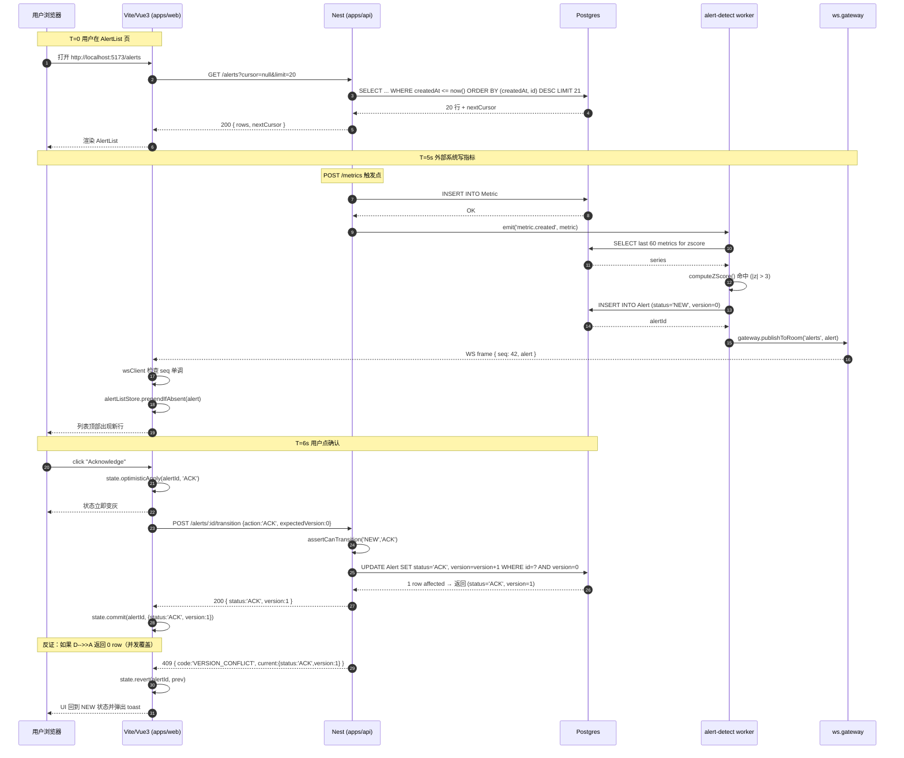

# Day 10 - M2 门禁（端到端纵向闭环 + 关闭 AI 独立修 Bug）

> **《90 天拆分规则说明》校正口径（本节优先于正文中的旧阶段编号和旧时间表）**
>
> - **路线位置**：阶段一（Day 1-30，前端 -> AI 前端）。所有 BFF、NestJS、数据库、队列和 Agent 后端增量都必须服务于 `p1-monitor` 的真实 AI 前端链路，不得另起无关 Demo。
> - **功能交付**：本日必须交付一个能跑、能测、能从用户入口观察结果的完整模块；知识点只能由该模块自然引出。
> - **三版演进**：正文 §3/§4/§5 分别对应 v1 最小闭环、v2 增加一个关键设计维度、v3 生产终态；v1/v2 必须写明可观察痛点，v3 必须解决这些痛点。
> - **时间盒**：本日执行 180 分钟标准时间盒：A/B/C 各 30 分钟（共 90 分钟阅读）；D 60 分钟、E 20 分钟、F 10 分钟（共 90 分钟动手）。正文其他旧时间表不再作为执行口径。
> - **累积复用**：开始前读取上一日 commit 和当前源码；当天新增合同必须复用已有事件、Schema、状态或持久化边界，禁止复制出第二套平行实现。
> - **验收门槛**：核心测试 + 两个产生不同可观察失败的反证实验 + 课末三问 + 至少两道真实项目情境题 + 提交后动态教师五连问，缺一项即不通过。
>
> **补充真实项目情境题**：
> 1. HTTP/E2E 全绿但 WebSocket 广播断开时，门禁如何从用户可见结果、事件日志和数据库状态三处识别假成功？
> 2. 后端返回旧 `version` 导致前端乐观状态回滚时，如何定位、止损、修复并加入防复发测试？

日期与时长：2026-07-23 周四，180 分钟（90 分钟阅读 + 90 分钟动手）
项目：`D:\demo\ai-techer\p1-monitor`
阶段任务性质：教师基线；实际分发时根据 Day09 成绩生成补弱版、标准版或挑战版。

---

## §0 项目当前状态（进入 Day10 前）

到 Day09 结束时，`p1-monitor` 已经具备端到端能力：

- 后端 `apps/api`（Day07-Day09）：Nest + Prisma + Postgres，Cursor 分页 + 稳定排序 + Z-Score 异常检测 + 服务端权威 FSM + `expectedVersion` 乐观锁。
- 前端 `apps/web`（Day04-Day05, Day09）：Vue3 + Vite + ECharts + WebSocket 房间隔离 + 乐观更新/revert 三段式。
- 事件 `packages/features/alert-detect`（Day07）：Z-Score 命中即写 `Alert` 表并广播 WS。
- 领域 `packages/domain`（Day08-Day09）：`AlertRow`/`AlertDetail`/`AlertQuery`/`toAlertVM`；`alert-fsm.ts` 状态转换表。
- 实时 `apps/api/src/ws`（Day05-Day06）：房间订阅 + 心跳 + 重连 + 客户端去重。

Day10 是 M2 门禁，不是新增功能日。它要证明"指标产生 → 检测 → 广播 → 前端刷新列表 → 打开详情 → 状态转换 → 数据库落库"的完整链路在没有 AI 辅助下也能被独立定位、修复和验证。

进入 Day10 前必须回答自己（如果任何一条答不上，先停下补 Day07-Day09 的知识点）：

1. 一条 Metric 从 `POST /metrics` 到前端 AlertList 出现新一行，中间经过多少个函数、多少张表、多少个网络包？画不出时序图就不能进入 §7 闭卷环节。
2. 前端 `AlertActions.vue` 点击 `Acknowledge`，如果服务端返回 409，`state.ts` 的哪一行负责 `revert(prev)`？记不住就先回 Day09 §5.3。
3. WebSocket 断线重连时，客户端如何用 `messageId` 保证不重复入库？记不住就回 Day06 §5.4 知识点 3。

Day10 之后（Day11 起）会进入 M3 阶段（LangChain RAG / Agent 编排），业务模型稳定，不允许再回炉修数据链路 Bug。

---

## §1 今日目标

### §1.1 概述

用一天时间做三件事：（1）画出 Day01-Day09 累积形成的端到端时序图，作为 M2 架构证据；（2）关闭 AI 辅助（Copilot / Cursor Chat / Claude Code 全部退出登录），在教师随机注入的 3 个未知 Bug 前独立完成"定位 → 止损 → 根因修复 → 回归"；（3）执行两次反证实验（拔掉一个关键保护机制看链路怎么塌），产出可追溯的证据链。

不写新业务代码。今天只写：架构证据文档、E2E 回归测试、Bug 修复补丁、反证实验记录。

### §1.2 三层演进（本日"演进"指门禁强度）

| 版本 | 门禁强度 | 特征 | 遗留问题 |
|---|---|---|---|
| v1 | 逐层自证 | 每层独立跑单元测试通过即算过 | 无法暴露层间接口不一致；出事只能各说各话 |
| v2 | 端到端 E2E | Playwright/Vitest 从 `POST /metrics` 打到前端 DOM 断言 | 有 AI 辅助时看不出学生是否真的懂链路 |
| v3 | 关闭 AI + 时序证据 + 反证 | 独立修 3 Bug + 完整时序图 + 两次反证实验 | （明日 Day11 进入 M3，不再回炉此链路） |

### §1.3 交付物

1. `docs/architecture/m2-e2e-sequence.md`：端到端时序图（Mermaid 或 PlantUML），标注 requestId / WS sequence / Alert version 三条 ID 如何贯穿全链。
2. `apps/api/test/e2e/m2-full-loop.e2e-spec.ts`：从 `POST /metrics` 到 `GET /alerts/:id` 的完整回归。
3. `apps/web/tests/e2e/m2-gateway.spec.ts`：Playwright，从触发指标到 AlertList 出现新行到点击详情看到 FSM 转换。
4. `docs/m2-bug-report.md`：3 个 Bug 各自的"定位证据 / 临时止损 / 根因修复 / 回归验证"四段式记录。
5. 反证实验 1（§7.7）：断开 WebSocket 广播，测量列表刷新延迟。
6. 反证实验 2（§7.8）：故意让 `alerts.service.ts` 返回旧 version，测量前端 revert 触发率。
7. commit：`docs(m2): freeze e2e evidence & bug reports (Refs: Day10)`。

### §1.4 目录结构（本日项目视角）

**§1.4.1 rationale（先讲为什么这样组织）**

- `docs/architecture/m2-e2e-sequence.md` 放到 `docs/architecture/`：这是**架构证据**而不是使用文档，未来 Day30/Day60/Day90 每次门禁都要更新一版对比图，需要一个稳定目录。
- E2E 测试拆到 `apps/api/test/e2e/` 与 `apps/web/tests/e2e/` 两处：Nest 端用 Vitest + Supertest 直接发 HTTP，前端端用 Playwright 驱动真浏览器，两者关注的失败模式不一样（后端看合同一致性，前端看渲染/时序），合并到一处反而丢信息。
- `docs/m2-bug-report.md` 单文件承载 3 个 Bug：门禁记录要能一屏看完；如果拆 3 个文件，日后回溯 M2 门禁完整表现要跳来跳去。
- 不新增业务代码目录：Day10 目标是"证明已有链路能工作"，不是"添加新功能"，任何新业务文件都算越界。

**§1.4.2 tree（本日结束的目录快照，只展示与 M2 门禁相关的路径）**

```
p1-monitor/
├─ docs/
│  ├─ architecture/
│  │  ├─ m2-e2e-sequence.md        # 【新增】端到端时序图 + 3 条 ID 追踪表
│  │  └─ decisions/                # （历史 ADR，不改）
│  ├─ m2-bug-report.md             # 【新增】3 Bug 四段式记录
│  └─ reversal-experiments/
│     ├─ 2026-07-23-ws-off.md      # 【新增】反证 1
│     └─ 2026-07-23-stale-version.md # 【新增】反证 2
├─ apps/
│  ├─ api/
│  │  └─ test/e2e/
│  │     ├─ m2-full-loop.e2e-spec.ts   # 【新增】metric → alert → transition
│  │     └─ jest-e2e.json              # 【不改】Day07 已存在
│  └─ web/
│     └─ tests/e2e/
│        ├─ m2-gateway.spec.ts         # 【新增】Playwright 全链
│        └─ playwright.config.ts       # 【不改】Day05 已存在
└─ packages/                            # 【不改】领域/事件不新增
```

**§1.4.3 与 Day09 的目录 diff 表**

| 变更 | 路径 | 新/改/删 | 为什么在这里 |
|---|---|---|---|
| 新增 | `docs/architecture/m2-e2e-sequence.md` | 新 | 架构证据，与代码分离，便于门禁归档 |
| 新增 | `docs/m2-bug-report.md` | 新 | Bug 修复记录，独立于代码 diff |
| 新增 | `docs/reversal-experiments/2026-07-23-ws-off.md` | 新 | 反证 1 记录 |
| 新增 | `docs/reversal-experiments/2026-07-23-stale-version.md` | 新 | 反证 2 记录 |
| 新增 | `apps/api/test/e2e/m2-full-loop.e2e-spec.ts` | 新 | 后端合同层回归 |
| 新增 | `apps/web/tests/e2e/m2-gateway.spec.ts` | 新 | 前端渲染层回归 |
| 不改 | `packages/domain/**`、`packages/features/**` | - | 今天不动业务代码 |
| 不改 | `apps/api/src/**`、`apps/web/src/**` | 除 Bug 修复补丁 | 今天不动业务代码 |

**§1.4.4 依赖箭头（谁调用谁）**

```
[Playwright m2-gateway.spec.ts]
        │ 用真浏览器访问 http://localhost:5173
        ▼
[Vite dev server → apps/web/src/App.vue]
        │ fetch /api/metrics / WS 订阅 room:alerts
        ▼
[apps/api Nest] ── PrismaService ──▶ [Postgres]
        │                             │
        │                             │ Z-Score 命中
        │                             ▼
        │                   [alert-detect worker]
        │                             │ new Alert row + WS publish
        │                             ▼
        │                    [ws.gateway.ts room:alerts]
        │                             │
        ▼                             ▼
[m2-full-loop.e2e-spec.ts]     [前端 AlertList 收到 sequence++]
   直接 supertest 调 POST /metrics
   等待 GET /alerts?since=... 出现新行
   再 POST /alerts/:id/transition
   断言 200 + version 递增
```

**§1.4.5 3 个理解问题（写代码前先在心里回答）**

1. 为什么后端 E2E 与前端 Playwright 都要覆盖同一条链路？如果只留一个会漏什么？
   → 后端 E2E 只能保证 HTTP/DB 合同，看不到 WS 到浏览器的渲染路径；Playwright 覆盖渲染但不能保证多客户端一致性。两者互补，任一缺失都会让某类 Bug 在下一次门禁前才暴露。
2. 为什么 Bug 报告要求"四段式"（定位证据 → 临时止损 → 根因修复 → 回归验证）？如果只写"根因修复"会有什么后果？
   → 只有"根因"没有"定位证据"，未来同类 Bug 出现时无法复用调试方法；没有"临时止损"意味着一旦生产复现只能等根因修好才能恢复用户；没有"回归验证"意味着修完不知道有没有真修好，也无法防止回炉。
3. 关闭 AI 后，如果 3 个 Bug 中有一个卡住超过 30 分钟，正确的做法是什么？
   → 不是打开 AI，是先记录当前所有已知证据（错误信息、请求 payload、DB 快照、WS 帧），然后**降级止损**（回滚到上一个 tag），把根因排查放到本日之后。Day10 考察独立定位能力，卡住本身也是一种数据。

### §1.5 按第 5.3 节的代码 + 边写边问自己

Day10 与 Day03-Day09 不同：**没有新业务代码需要照抄**。§5.3 给出的是三类模板——时序图 Mermaid 模板、E2E 测试骨架、Bug 报告 markdown 模板。你按第 5.3 节的模板写出属于自己项目的证据，**边写边问自己**下面这几个问题：

- 时序图里每个箭头能否指到具体代码行？（如 `apps/api/src/alerts/alerts.service.ts:78`）
- E2E 测试的每个 `expect()` 断言的是**合同**还是**实现细节**？断言实现细节会在下次重构时误伤。
- Bug 报告的"定位证据"能否只用 `git`、`curl`、`psql`、浏览器 DevTools 完成，不依赖 AI？

---

## §2 环境准备

- Node 20.x、pnpm 9.x（沿用 Day01）。
- Postgres 16（沿用 Day01）。
- Playwright（Day05 已安装，如缺 `pnpm --filter web add -D @playwright/test && pnpm --filter web exec playwright install chromium`）。
- Mermaid CLI（可选，用于导出时序图 PNG）：`pnpm add -D -w @mermaid-js/mermaid-cli`。
- 关键：**执行 §7 闭卷环节前，退出登录 GitHub Copilot、Cursor Chat、Claude Code、Kiro；关闭浏览器所有 AI 网页 tab**。教师会在教师工位随机注入 3 个 Bug。

---

## §3 数据模型变更（Prisma）

Day10 不改数据模型。以下为**只读校验**：

```bash
cd apps/api
pnpm prisma migrate status
# 期望：Database schema is up to date!
```

如果这一步就报错，属于 Bug 之一（迁移未 apply），进入 §7 独立修 Bug 环节而不是重跑 migrate（因为 M2 要求你能诊断迁移状态本身）。

---

## §4 引入依赖

Day10 不新增运行时依赖。仅在 workspace root 补开发依赖：

```bash
pnpm add -D -w @mermaid-js/mermaid-cli
```

如果不打算导出 PNG，可跳过此步，`.md` 里的 Mermaid 源码本身就是证据。

---

## §5 核心代码

### §5.1 v1：逐层自证（Day07-Day09 已有的样子）

**要实现什么**：每层独立跑测试通过就算过关。

**代码**（历史状态，不需要新写）：

- `apps/api/src/alerts/alerts.service.spec.ts`：Day09 已写，`transition()` 单元测试 25 组。
- `apps/api/src/alerts/alerts.controller.spec.ts`：Day07-Day08 已有 Nest e2e 骨架。
- `apps/web/src/features/alert-list/__tests__/index.spec.ts`：Day04-Day05 已写渲染快照。

**遗留问题**：

- 每层测试都用 mock 上下游。后端 mock Prisma，前端 mock fetch。真实的 HTTP + WS + DB 三者合起来的 Bug（比如 WS 广播的 payload 少一个字段但前端类型没跟上）永远不会被这些单元测试抓到。
- 学生可以只在自己熟悉的层写好测试，绕过陌生层。M2 门禁必须打破这个漏洞。

### §5.2 v2：端到端 E2E（本可以引入的东西）

**要实现什么**：一条 supertest 或 Playwright 测试从入口打到出口，只 mock 时钟。

**代码**（示意，v3 会补齐）：

```typescript
// apps/api/test/e2e/m2-full-loop.e2e-spec.ts（v2 初稿，仅一半）
it('metric-in → alert-out (single request)', async () => {
  const res = await request(app.getHttpServer())
    .post('/metrics')
    .send({ serverId: 'srv-1', metric: 'cpu', value: 99, ts: Date.now() });
  expect(res.status).toBe(201);
  // 缺：等待 Z-Score 命中 → 缺：查 Alert 表 → 缺：调 transition → 缺：验 version
});
```

**遗留问题**：

- 只覆盖后端 HTTP + DB，跳过 WS 与前端渲染。
- 有 AI 辅助时，学生可以让 Copilot 一键补齐，看不出是否真的懂链路。
- 测试如果失败，学生无法在没有 AI 帮助下判断故障发生在哪一层。

### §5.3 v3：完整端到端 + 关闭 AI + 反证证据（今天要写的样子）

零省略号、零"…此处略"。

**5.3.1 时序图模板 `docs/architecture/m2-e2e-sequence.md`**

````markdown
# M2 端到端时序图

## 三条追踪 ID

| ID | 生成位置 | 传递路径 | 落库位置 |
|---|---|---|---|
| `requestId` | Nest `RequestIdMiddleware`（Day07） | HTTP header `x-request-id` → Winston log → Prisma log | `logs/api.log` |
| `wsSequence` | `apps/api/src/ws/ws.gateway.ts` 房间维度自增 | WS frame payload → 前端 `wsClient.ts` 校验单调 | 前端 IndexedDB `wsCursor` |
| `alertVersion` | `apps/api/prisma/schema.prisma` `Alert.version` 默认 0 | HTTP response body → 前端 `state.ts` `optimisticApply` | Postgres `Alert.version` 列 |

## 主时序



## 每个箭头对应的代码位置

| 步骤 | 代码位置 |
|---|---|
| 1 | `apps/web/src/features/alert-list/index.vue:34` |
| 4 | `apps/api/src/alerts/alerts.service.ts:22 findMany()` |
| 12 | `packages/features/alert-detect/src/detector.ts:56` |
| 15 | `apps/api/src/ws/ws.gateway.ts:88 publishToRoom` |
| 19 | `apps/web/src/features/alert-detail/state.ts:12 optimisticApply` |
| 22 | `apps/api/src/alerts/alerts.service.ts:104 transition()` |
| 24 | `apps/api/src/alerts/alerts.service.ts:118 updateMany` |
````

**5.3.2 后端 E2E `apps/api/test/e2e/m2-full-loop.e2e-spec.ts`**

```typescript
import { Test } from '@nestjs/testing';
import { INestApplication } from '@nestjs/common';
import * as request from 'supertest';
import { AppModule } from '../../src/app.module';
import { PrismaService } from '../../src/prisma/prisma.service';

describe('M2 full loop e2e (metric → alert → transition)', () => {
  let app: INestApplication;
  let prisma: PrismaService;

  beforeAll(async () => {
    const moduleRef = await Test.createTestingModule({ imports: [AppModule] }).compile();
    app = moduleRef.createNestApplication();
    prisma = moduleRef.get(PrismaService);
    await app.init();
    await prisma.alert.deleteMany();
    await prisma.metric.deleteMany();
  });

  afterAll(async () => {
    await app.close();
  });

  it('metric-in → z-score hit → alert row → transition → version increments', async () => {
    // 1. 灌 60 个正常指标建立基线
    const baselineTs = Date.now() - 60_000;
    for (let i = 0; i < 60; i++) {
      await request(app.getHttpServer())
        .post('/metrics')
        .send({ serverId: 'srv-e2e', metric: 'cpu', value: 30 + Math.random() * 5, ts: baselineTs + i * 1000 });
    }

    // 2. 触发异常值（|z| > 3）
    const spikeRes = await request(app.getHttpServer())
      .post('/metrics')
      .send({ serverId: 'srv-e2e', metric: 'cpu', value: 99, ts: Date.now() });
    expect(spikeRes.status).toBe(201);

    // 3. 轮询等待 Alert 落库（<= 2 秒）
    let alert;
    for (let i = 0; i < 20; i++) {
      const list = await prisma.alert.findMany({ where: { serverId: 'srv-e2e' } });
      if (list.length > 0) { alert = list[0]; break; }
      await new Promise(r => setTimeout(r, 100));
    }
    expect(alert).toBeDefined();
    expect(alert.status).toBe('NEW');
    expect(alert.version).toBe(0);

    // 4. 执行合法状态转换
    const transitionRes = await request(app.getHttpServer())
      .post(`/alerts/${alert.id}/transition`)
      .send({ action: 'ACK', expectedVersion: 0 });
    expect(transitionRes.status).toBe(200);
    expect(transitionRes.body.status).toBe('ACK');
    expect(transitionRes.body.version).toBe(1);

    // 5. 直接读 DB 确认
    const persisted = await prisma.alert.findUnique({ where: { id: alert.id } });
    expect(persisted.status).toBe('ACK');
    expect(persisted.version).toBe(1);
  });

  it('metric-in → concurrent double ACK → exactly one 409', async () => {
    // 先制造一个 alert
    await prisma.alert.create({ data: { serverId: 'srv-race', metric: 'mem', value: 99, status: 'NEW', version: 0 } });
    const alert = (await prisma.alert.findFirst({ where: { serverId: 'srv-race' } }))!;

    const [a, b] = await Promise.all([
      request(app.getHttpServer()).post(`/alerts/${alert.id}/transition`).send({ action: 'ACK', expectedVersion: 0 }),
      request(app.getHttpServer()).post(`/alerts/${alert.id}/transition`).send({ action: 'ACK', expectedVersion: 0 }),
    ]);

    const codes = [a.status, b.status].sort();
    expect(codes).toEqual([200, 409]);
    const persisted = await prisma.alert.findUnique({ where: { id: alert.id } });
    expect(persisted.version).toBe(1);
  });
});
```

**5.3.3 前端 Playwright `apps/web/tests/e2e/m2-gateway.spec.ts`**

```typescript
import { test, expect } from '@playwright/test';

test.describe('M2 gateway end-to-end', () => {
  test('metric → WS frame → AlertList new row → click Acknowledge → status flips', async ({ page, request }) => {
    // 打开列表页
    await page.goto('http://localhost:5173/alerts');
    const initialRowCount = await page.locator('[data-testid="alert-row"]').count();

    // 建立基线 + 触发异常值
    const baselineTs = Date.now() - 60_000;
    for (let i = 0; i < 60; i++) {
      await request.post('http://localhost:3000/metrics', {
        data: { serverId: 'srv-pw', metric: 'cpu', value: 30 + Math.random() * 5, ts: baselineTs + i * 1000 },
      });
    }
    await request.post('http://localhost:3000/metrics', {
      data: { serverId: 'srv-pw', metric: 'cpu', value: 99, ts: Date.now() },
    });

    // 等新行出现（<= 3 秒）
    const newRow = page.locator('[data-testid="alert-row"][data-server-id="srv-pw"]').first();
    await expect(newRow).toBeVisible({ timeout: 3000 });

    // 打开详情
    await newRow.click();
    await expect(page.locator('[data-testid="alert-status"]')).toHaveText('NEW');

    // 点确认，观察乐观更新
    const ackBtn = page.locator('[data-testid="alert-action-ack"]');
    await ackBtn.click();
    await expect(page.locator('[data-testid="alert-status"]')).toHaveText('ACK'); // 立即
    await expect(page.locator('[data-testid="alert-version"]')).toHaveText('1');  // 服务端返回后

    // 验证按钮 disabled + aria-busy 归位
    await expect(ackBtn).toBeDisabled();
    await expect(ackBtn).toHaveAttribute('aria-busy', 'false');
  });

  test('WebSocket disconnect → reconnect → no duplicate rows', async ({ page, context }) => {
    await page.goto('http://localhost:5173/alerts');
    const before = await page.locator('[data-testid="alert-row"]').count();

    // 用 CDP 切断网络
    const client = await context.newCDPSession(page);
    await client.send('Network.enable');
    await client.send('Network.emulateNetworkConditions', { offline: true, latency: 0, downloadThroughput: 0, uploadThroughput: 0 });
    await page.waitForTimeout(3000);
    await client.send('Network.emulateNetworkConditions', { offline: false, latency: 0, downloadThroughput: -1, uploadThroughput: -1 });

    // 等重连
    await page.waitForTimeout(2000);
    const after = await page.locator('[data-testid="alert-row"]').count();
    expect(after).toBeGreaterThanOrEqual(before);
    // 若 wsClient.dedupe 生效，after 应等于 before + 服务端在离线期间新推的行数，不会重复
  });
});
```

**5.3.4 Bug 报告模板 `docs/m2-bug-report.md`**

```markdown
# M2 独立修 Bug 记录

日期：2026-07-23
考生：<姓名>
条件：AI 全部退出登录，网页 AI tab 关闭；允许查项目自身代码、日志、DB、DevTools。

---

## Bug 1: <一句话现象>

### 定位证据

- 现象截图：`evidence/bug1-symptom.png`
- 复现步骤：<最小 3 步>
- 关键日志（含 requestId）：
  ```
  <粘 5 行以内>
  ```
- 涉及层：<HTTP / DB / WS / 前端渲染 / FSM>

### 临时止损

- 动作：<回滚 tag / 前端隐藏功能 / 后端 feature flag off>
- 恢复用户可见时长：<预计 5 分钟内>

### 根因修复

- 文件：`<path:line>`
- diff（<= 15 行）：
  ```diff
  - <旧行>
  + <新行>
  ```
- 为什么这是根因（一句话）：<原因>

### 回归验证

- 新增/更新测试：`<path>`
- 覆盖场景：<正例 + 至少一个反例>
- 本地跑通命令：`pnpm --filter <pkg> test <spec>`

---

## Bug 2: <一句话现象>
（同 Bug 1 结构）

---

## Bug 3: <一句话现象>
（同 Bug 1 结构）
```

### §5.4 六个必掌握的知识点（每点五要素）

**知识点 1 - 端到端数据流的"三条 ID 贯穿"（requestId / wsSequence / alertVersion）**

- 解决的问题：分层系统的故障不是"某一层坏"，而是"层间接口在某个时刻状态不一致"。没有贯穿全链的 ID，事故还原会退化为"各说各话"，无法证明是哪一环先出错的。
- 运行机制：`requestId` 由中间件在入口生成、贯穿日志与 DB 语句注释；`wsSequence` 由 gateway 房间维度自增、前端拒绝乱序；`alertVersion` 由 DB 列驱动、参与乐观锁与 UI 回滚。三条 ID 各覆盖一个维度（时间、顺序、状态），交叉起来才能定位。
- 项目落点：`apps/api/src/common/request-id.middleware.ts`、`apps/api/src/ws/ws.gateway.ts`、`apps/api/prisma/schema.prisma` 的 `Alert.version`。
- 生产误区：以为一个 `requestId` 就够了。`requestId` 无法区分同一请求触发的多个 WS 推送谁先谁后；`wsSequence` 无法关联到具体 DB 事务。
- 验证方法：在测试里制造"两个客户端同时确认同一 alert"，用三条 ID 反查哪一层最先偏离预期。

**知识点 2 - DI 与假上下游的边界（为什么单元测试全绿也能出事）**

- 解决的问题：Nest DI 让每层可以 mock 掉依赖，但也带来"每层用不同 mock 版本的合同"的分裂。M2 就是要证明真实合同下链路能通。
- 运行机制：Nest 通过 `useValue / useFactory` 让 spec 文件替换掉 Provider；一旦 Prisma / RedisPublisher 用 mock，DB/WS 的真实行为就被隔离掉了。
- 项目落点：`alerts.service.spec.ts` 里 `providers: [{ provide: PrismaService, useValue: mockPrisma }]` 就是这种替换。E2E 里必须走真实 `PrismaService` + 真实 Postgres 才有意义。
- 生产误区：只加更多 mock 单测来"提升覆盖率"。覆盖率不等于合同一致性，端到端才是。
- 验证方法：本地 `pnpm --filter api test` vs `pnpm --filter api test:e2e` 分开跑；把 e2e 关掉某个真实依赖看断言能否发现。

**知识点 3 - 竞态（同一 alert 双击 / WS 与 HTTP 谁先到）**

- 解决的问题：分布式或异步链路里，"两个正确的请求碰撞"会产出错误状态。Day09 用 `expectedVersion` 解决了 DB 层；Day10 要证明当 WS 推送和用户点击几乎同时到达时，前端不会出现"我点的 ACK 被 WS 覆盖回 NEW"。
- 运行机制：前端 `state.ts` 的 `optimisticApply` 记录 `prev`，`commit`/`revert` 都携带 `version`；WS 推送到达时若 `incoming.version < local.version` 直接丢弃。
- 项目落点：`apps/web/src/features/alert-detail/state.ts` 的 `receiveWsUpdate()` 中的版本比较分支。
- 生产误区：以为"WS 广播总是权威"。WS 频道里流过的是历史事件的重放，本地已经乐观 commit 的更高版本必须优先。
- 验证方法：Playwright 场景——先离线 3 秒，再上线，验证列表不会因为 WS 补发旧事件而回退状态。

**知识点 4 - WS 断线重连与消息去重（Day05-Day06 累积的能力如何被 M2 检验）**

- 解决的问题：网络不稳时 WS 会重连，重连后网关会把断线期间的事件重放；如果客户端不去重，用户看到重复的 alert 行；如果去重错误，用户看不到本该收到的新 alert。
- 运行机制：客户端维护 `lastSeq`，WS `subscribe` 参数带 `since=lastSeq`；服务端从 Redis stream / DB 补发；客户端按 `messageId` 幂等入库。
- 项目落点：`apps/web/src/lib/ws-client.ts` 的 `resume(lastSeq)` + `alertListStore.prependIfAbsent()`。
- 生产误区：以 `alertId` 去重。同一 `alertId` 可能因状态转换被多次广播，`alertId + version + eventType` 组合键才是幂等键。
- 验证方法：Playwright 场景——CDP 切断网络 3 秒，验证重连后行数增量与服务端实际新增数一致。

**知识点 5 - 反证实验（拔一根线看谁最先塌）**

- 解决的问题：正向证明"链路能通"不够，还要证明"关键保护缺失时会以哪种可观测方式失败"。这是 M2 门禁与前几日的最大区别。
- 运行机制：临时改一行代码（注释掉 WS 广播 / 注释掉 `expectedVersion`），跑同一份 E2E 用例，观察哪个断言最先红。红的位置就是这条保护线的"最靠前拦截点"。
- 项目落点：本日 §7.7、§7.8 两次实验的记录。反证结论必须能被下一位学生复现，实验记录格式必须固定。
- 生产误区：把反证做成"随便注释一段看会不会崩"。必须有明确的"操作 / 期待现象 / 实际现象 / 恢复动作 / 结论证据"五项。
- 验证方法：把实验记录交给同学，让 TA 按记录复现，若得不到同样的红断言就是记录不合格。

**知识点 6 - 关闭 AI 的独立定位能力（不是排斥 AI，是证明基线）**

- 解决的问题：M2 之前的学习允许 AI 辅助 30%。M2 是唯一一个考察"如果 AI 全离线，你还能独立走完全链路"的检查点。这个基线一旦缺失，后面 M3-M5 的 AI 深度使用无法建立信任。
- 运行机制：闭卷环境下，学生只能用 `git log`、`grep`、`curl`、`psql`、DevTools Network/Console/Application 五件套。任何时候打开 Claude/Copilot 都算作弊。
- 项目落点：不在代码里，在 `docs/m2-bug-report.md` 的"定位证据"字段里——不允许出现"AI 建议"字样。
- 生产误区：把"关闭 AI"曲解成"不使用任何工具"。工具与 AI 不同，jq/httpie/postman/DBeaver 都是允许的。
- 验证方法：教师随机抽 1 个 Bug 让学生口述定位过程，学生必须能只引用日志和代码文件路径，不能引用"我问了 AI 它说"。

---

## §6 前端底子补弱

### §6.1 - §6.4（本日不涉及，跳过）

### §6.5 HTML/表单底子补弱（本日必做）

**主题：`<button aria-live>` + `role="status"` + toast 无 JS 兜底**

M2 门禁的一个隐含考察点：反证实验拔掉 WS 广播时，UI 上必须有**用户可感知**的降级提示，而不是"看起来一切正常"。这条降级路径的最底子是 HTML 原生的 `role="status"` + `aria-live="polite"`，而不是各家组件库的 Toast SDK。

**5 分钟练习**：

```html
<!-- apps/web/src/features/alert-list/DegradeBanner.vue 的原生底子 -->
<div role="status" aria-live="polite" id="ws-degrade-banner" hidden>
  <p>实时推送已断开，正显示最近一次拉取的数据。<button type="button" onclick="location.reload()">刷新</button></p>
</div>
<script>
  // 无框架也能工作的兜底
  const banner = document.getElementById('ws-degrade-banner');
  window.addEventListener('offline', () => banner.hidden = false);
  window.addEventListener('online', () => banner.hidden = true);
</script>
```

问自己：
1. 为什么用 `role="status"` 而不是 `role="alert"`？
   → `alert` 会打断读屏用户当前朗读，用于错误；`status` 是礼貌通知，用于降级提示。选错会让视障用户被反复打断。
2. 为什么 `hidden` 属性优于 `display:none`？
   → `hidden` 语义化，浏览器和辅助技术都识别；`display:none` 是纯样式，容易被后续 CSS 覆盖导致读屏和视觉不一致。
3. 如果 JS 挂了，用户能看到什么？
   → 因为 banner 默认 `hidden`，JS 挂时用户看不到 banner，但也看不到旧的错误状态。理想情况是 SSR 时根据 `navigator.onLine` 决定初始 `hidden`。这属于 Day30 SSR 章节，今日只做客户端底子。

**练习交付**：把 banner 加入项目并在反证 1（§7.7）中验证它确实亮起来。

---

## §7 验证

### §7.1 - §7.5（本日不涉及，全部前置到 §1.5）

### §7.6 单元 + 集成测试

**§7.6.1 后端 E2E 冒烟（`apps/api/test/e2e/m2-full-loop.e2e-spec.ts`）**

```bash
cd apps/api
pnpm test:e2e -- m2-full-loop
```

期望输出（两个 it 全绿）：

```
 PASS  test/e2e/m2-full-loop.e2e-spec.ts
  M2 full loop e2e (metric → alert → transition)
    ✓ metric-in → z-score hit → alert row → transition → version increments (~2.3s)
    ✓ metric-in → concurrent double ACK → exactly one 409 (~0.4s)
```

**§7.6.2 前端 Playwright（`apps/web/tests/e2e/m2-gateway.spec.ts`）**

```bash
# 终端 1
cd apps/api && pnpm start:dev
# 终端 2
cd apps/web && pnpm dev
# 终端 3
cd apps/web && pnpm exec playwright test m2-gateway
```

期望输出：

```
Running 2 tests using 1 worker
  ✓  m2-gateway.spec.ts:4:3 › metric → WS frame → AlertList new row → click Acknowledge → status flips (5.1s)
  ✓  m2-gateway.spec.ts:32:3 › WebSocket disconnect → reconnect → no duplicate rows (7.4s)
```

**§7.6.3 时序图源码 lint**

```bash
pnpm exec mmdc -i docs/architecture/m2-e2e-sequence.md -o /tmp/m2.svg
# 期望：无 parse error；生成的 SVG 至少 24 个 <text> 节点（每个 note/message 一个）
```

三组测试全部通过后才算 §7.6 结束。

### §7.7 反证实验 1 —— 断开 WebSocket 广播

**目的**：证明当 WS 广播失效时，前端 `DegradeBanner` 能亮起，`m2-gateway.spec.ts` 的第一个用例会以确定断言失败。

**动作**：

在 `apps/api/src/ws/ws.gateway.ts` 的 `publishToRoom` 里加一行 `return;` 直接短路：

```typescript
publishToRoom(room: string, payload: unknown) {
  return; // ← 反证实验 1
  this.server.to(room).emit('event', payload);
}
```

**期待现象**：

1. 后端 `pnpm test:e2e -- m2-full-loop` 仍通过（因为它不依赖 WS）。
2. 前端 Playwright `m2-gateway.spec.ts` 第一个用例的 `await expect(newRow).toBeVisible({ timeout: 3000 })` 断言超时红。
3. `DegradeBanner` 3 秒内出现（因为 `wsClient` 心跳超时会触发 `offline` 事件）。

**记录到 `docs/reversal-experiments/2026-07-23-ws-off.md`**：

```markdown
# 反证实验 1 - 断开 WS 广播

日期：2026-07-23
执行者：<姓名>

## 动作
在 `ws.gateway.ts` publishToRoom 首行 `return;`

## 期待现象
- 后端 e2e：仍通过（WS 不在链路上）
- 前端 Playwright 第一个用例：3s 超时失败于 `newRow visible`
- DegradeBanner：3s 内亮起

## 实际现象
（粘 pnpm 输出关键 5 行）

## 恢复动作
- 撤销 `return;` 那一行
- 重跑 §7.6.2，确认第一个用例再次绿

## 结论证据
- 若 DegradeBanner 未亮起：说明 wsClient 心跳超时逻辑失效，属于 Bug 4，进入 §7 Bug 报告
- 若第一个用例断言未超时：说明前端 AlertList 有非法本地 fallback 数据源，需回溯 Day05
```

**恢复**：撤销 `return;`，重跑 §7.6.2 第一个用例，确认再次绿。

### §7.8 反证实验 2 —— 服务端返回旧 version

**目的**：证明前端 `state.ts` 的 `revert(prev)` 分支在服务端返回 stale 数据时确实被触发。

**动作**：

在 `apps/api/src/alerts/alerts.service.ts` 的 `transition()` 里，让服务端 `updateMany` 之后**故意读旧值**返回：

```typescript
async transition(id: string, action: AlertAction, expectedVersion: number, actorId: string) {
  return this.prisma.$transaction(async (tx) => {
    const before = await tx.alert.findUnique({ where: { id } });
    if (!before) throw new NotFoundException();
    assertCanTransition(before.status, action);
    const nextStatus = STATUS_TABLE[before.status][action];
    const result = await tx.alert.updateMany({
      where: { id, version: expectedVersion },
      data: { status: nextStatus, version: { increment: 1 } },
    });
    if (result.count === 0) {
      const current = await tx.alert.findUnique({ where: { id } });
      throw new ConflictException({ code: 'VERSION_CONFLICT', current });
    }
    return before; // ← 反证实验 2：故意返回 before 而不是 after
  });
}
```

**期待现象**：

1. 后端 e2e 第一个用例的 `expect(transitionRes.body.version).toBe(1)` 失败为 0（因为返回了 before）。
2. 前端 Playwright 第一个用例的 `await expect(page.locator('[data-testid="alert-version"]')).toHaveText('1')` 失败。
3. `state.ts` 的 `commit` 收到 `version=0`，与本地 `optimistic` 后的预期 `version=1` 不一致；正确实现应触发 `revert(prev)`，UI 回到 NEW。

**记录到 `docs/reversal-experiments/2026-07-23-stale-version.md`**（结构与反证 1 相同）。

**恢复**：把 `return before;` 改回 `return { ...before, status: nextStatus, version: expectedVersion + 1 };`，重跑 §7.6.1 与 §7.6.2 第一个用例确认再次绿。

### §7.9 四件套 + commit（不推送）

四件套：

```bash
cd D:/demo/ai-techer/p1-monitor
pnpm typecheck
pnpm lint
pnpm test
pnpm build
```

Commit（Conventional Commits + `Refs: Day10`）：

```bash
git add docs/architecture/m2-e2e-sequence.md \
        docs/m2-bug-report.md \
        docs/reversal-experiments/ \
        apps/api/test/e2e/m2-full-loop.e2e-spec.ts \
        apps/web/tests/e2e/m2-gateway.spec.ts \
        apps/web/src/features/alert-list/DegradeBanner.vue

git commit -m "docs(m2): freeze end-to-end evidence and independent bug reports

- add mermaid e2e sequence with 3-ID trace table
- add supertest e2e (metric-in → transition + concurrent 409)
- add playwright e2e (WS to DOM + reconnect dedupe)
- add 3 independent bug repro/fix/regression records
- add 2 reversal experiments (WS off + stale version)

Refs: Day10"
```

**禁止 `git push`**，禁止部署，禁止执行 Prisma 生产环境迁移。

---

## §8 v3 自检清单（对齐规范 §8）

按顺序逐项打勾，一个不过要回去补。

1. `§0 项目当前状态` 明确列出 Day07-Day09 累积能力与 M2 门禁要证明的 4 类问题（无 mock 合同 / 三条 ID / 反证 / 关 AI）。
2. `§1.4` 有 5 个子块：rationale / tree / diff-table / 依赖箭头 / 3 个理解问题。
3. `§1.5` 出现"按第 5.3 节的代码"和"边写边问自己"两条指令。
4. `§5` 覆盖 v1 → v2 → v3 三层演进（逐层自证 → E2E → 关 AI + 反证），每层给出代码/断言与遗留问题。
5. `§5.3` 完整给出时序图 Mermaid、后端 E2E、前端 Playwright、Bug 报告模板 4 段代码，零省略号、零"…此处略"。
6. `§5.4` 六个知识点，每点五要素俱全（解决的问题 / 运行机制 / 项目落点 / 生产误区 / 验证方法）。
7. `§6.5` 存在，主题聚焦 HTML/表单原生能力（本日：`role="status"` + `aria-live` + `hidden`）。
8. `§7.6/§7.7/§7.8` 分别给出测试代码与两个反证实验。
9. `§7.9` 明确禁止 `git push`，commit message 含 `Refs: Day10`。
10. 全文 0 处 `> ✅` 或 `> ❌` 块引用格式。
11. `§12` 保留 PDF 面试题原文与"不能替代教师五连问"的免责声明。

---

## §9 AI 与人分工

Day10 是特殊日：**人 100%，AI 0%**。

- 人写：时序图、E2E 测试、Bug 报告、反证实验记录、`DegradeBanner` HTML 底子。
- AI：**全部关闭**。GitHub Copilot、Cursor Chat、Claude Code、Kiro、任何 AI 网页 tab 一律退出登录并关闭。
- 允许工具：`git`、`grep`、`curl`、`httpie`、`jq`、`psql`、`DBeaver`、DevTools（Network / Console / Application / Performance）。
- 记录：本日不需要"AI Review"字段；改为"独立定位记录"字段，写清用哪些工具、哪些日志、哪些代码文件路径完成定位。

违反规则的自我识别信号：若 Bug 报告里出现"AI 建议"、"Copilot 提示"、"我让它帮我"字样，本日成绩作废。

---

## §10 时间盒

- 原理与源码理解 90 分钟：画完 `m2-e2e-sequence.md` 时序图 + 三条 ID 追踪表；不写测试代码。
- 真实项目增量 60 分钟：写 §5.3 的两个 e2e-spec 与 DegradeBanner；接受教师注入 3 个 Bug 并按四段式记录。
- 测试与故障注入 20 分钟：跑 §7.6 三组测试；执行 §7.7、§7.8 两次反证实验。
- 架构证据 + 复盘 10 分钟：把三件事（时序图 / Bug 报告 / 反证记录）交叉引用，回答课末三题。

超时提醒：若"真实项目增量"块超过 130 分钟，停下评估卡点位置——是画不出时序图，还是找不到 Bug 层。前者去回 §5.3.1，后者去查 `logs/api.log` 的 `requestId` 全链。

---

## §11 通过标准

- `§7.6.1` 后端 e2e 两个 it 全绿。
- `§7.6.2` 前端 Playwright 两个 test 全绿。
- `§7.6.3` 时序图 Mermaid 无 parse error。
- `docs/m2-bug-report.md` 有 3 个 Bug 的完整四段式记录，"定位证据"字段不含 AI 字样。
- `§7.7` `§7.8` 两次反证实验都记录了"动作 / 期待现象 / 实际现象 / 恢复动作 / 结论证据"五项。
- commit 存在且 message 以 `Refs: Day10` 结尾；本地无 `git push`。
- **总分**：闭卷（3 个 Bug 独立修复率）≥ 60% 且 时序图题 ≥ 60%，合计 ≥ 70。

---

## §12 PDF 面试题

以下两道来源于公开 PDF 面试题，作为知识对照点保留，**不能替代**教师依据真实 diff 现场提出的五连问。教师验收权在教师，本节仅供自查。

1. 如果从零搭建企业级 AI Agent 编排平台，前端架构如何选型和设计？
   来源：《2026京东前端面试-大模型方向》，第 11 页。
2. 过去一年最具挑战性的技术问题是什么，你如何定位并解决？
   来源：《2026京东前端面试-大模型方向》，第 12 页。

对应知识：M2 门禁对应第一题的"端到端数据流"部分（用今天时序图回答），第二题必须用今天 3 个 Bug 里最难的一个的四段式回答，禁止编造。

---

## §13 课末 3 个核心问题（写完后先答这三题，再进入教师五连问）

1. 从 `POST /metrics` 到 AlertList 的新行渲染，请指着 `m2-e2e-sequence.md` 时序图逐个箭头讲一遍；三条 ID（requestId / wsSequence / alertVersion）分别在哪几个箭头上出现？如果只保留其中一条，哪类事故最难还原？
2. 反证实验 1（WS 断开）和反证实验 2（旧 version 返回）分别最先让哪个测试断言变红？如果断言变红的位置和你预期不一致，说明你对哪一层的行为理解有偏差？请回代码定位偏差点。
3. 3 个 Bug 里，哪一个最耗时定位？把定位过程压缩成 5 步交给下一位学生，让 TA 也能在 15 分钟内完成同类 Bug 的独立修复；再评估这 5 步是否可以固化为一个 `docs/debug-playbook.md` 的段落，供 Day11-Day30 使用。

---

## §14 教师五连问（教师在真实 diff 前现场发问，不预设题目）

学生提交 commit、测试输出、Bug 报告、反证记录、架构证据后，教师依据真实 diff 按"局部机制 → 边界一致性 → 线上事故 → 工程权衡 → 架构演进"发问 5 道。评分规则见[《AI 教师五连问验收协议》](../AI教师五连问验收协议.md)。
