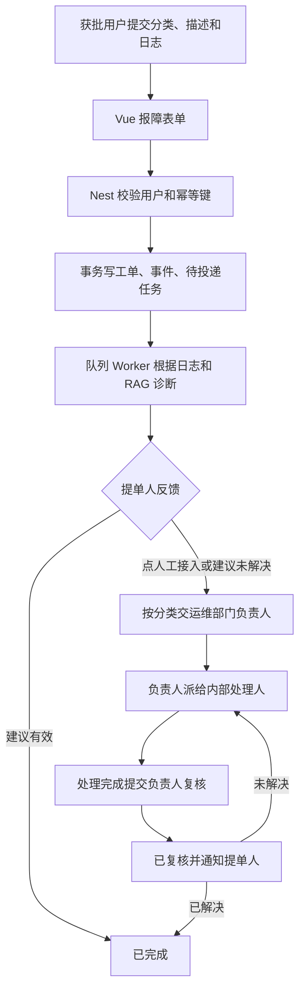

# 运维服务工单 · 全栈作品答辩

客户公司使用同一套服务台。甲、乙公司的工单可以交给同一个运维部门，客户可见范围仍按各自公司和登录身份计算。

## 八分钟演示

| 时间 | 讲述和现场操作 |
|---|---|
| 0–1 分钟 | 以甲公司普通用户创建工单。说明公司与承办部门各自决定什么。 |
| 1–3 分钟 | 指出提交事务的三类记录。用相同请求键重复提交，核对相同单号。 |
| 3–5 分钟 | 走人工接入、派单、处理、复核。用户点未解决时比较前后单号、处理人和版本。 |
| 5–7 分钟 | 对比正常和空闲超时两份流记录，解释前端如何区分收到部分文本与完整结束。 |
| 7–8 分钟 | 用乙公司身份请求甲公司单号，说明 404 与部门内部查询为何可以同时成立。 |

## 复现和故障复盘

从 [D146 集成演练](../教程/D146-走完一次故障处置与关单.md) 进入手写工程的接口用例，核对复核、返工、再次确认的事件。代理实验使用本地 Nginx 和受控上游。正常请求收齐 6 帧，空闲故障收到 1 帧后中断。观察第一帧只能判断已经开始，完成要查结束事件。恢复代理的空闲超时配置，再用同一输入重跑。[正常流](新版验收/D90-flow.txt) · [故障流](新版验收/D90-idle.txt) · [工单事件](新版验收/D160-clean.json)。

本机 Chromium 使用提单人、部门负责人和处理人三个登录会话，从页面报障走完人工接入、派单、处理、两次复核、回原人和用户确认。通知流按事件编号断开再连，下一条通知正确送达。 [浏览器记录](新版验收/D169-browser.json)。

个人提交请填写本人实现的模块、实测口述时长和一次亲手复现的差异。
