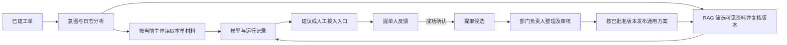

# 工单诊断 Agent · 作品答辩

## 八分钟演示

| 时间 | 讲述和现场操作 |
|---|---|
| 0–1 分钟 | 用同一张工单区别用户选择的路由分类和模型推断的故障原因。 |
| 1–3 分钟 | 打开一次 run，按步骤核对工具输入、可见范围、引用版本与停止原因。 |
| 3–5 分钟 | 模型证据不足时展示人工入口。再故意多插一次转人工事件，让门禁指出失败样本。 |
| 5–7 分钟 | 在同一题同一轮比较两种架构，展示预测、额外工具调用、token 和延迟。 |
| 7–8 分钟 | 演示一次负责人改稿，验证旧批准失效。指出其他客户能检索的通用步骤与原单日志的读取边界。 |

## 复现和故障复盘

以 [D160](../教程/D160-把工单评测接入持续集成.md) 的同一判分器读取两份事件。第一份退出 0，第二份在“提供人工入口”样本检测到多余事件，退出 1。回到 Worker，仅在用户点击后创建对应人工待办，再复跑正常轨迹。[正常轨迹](新版验收/D160-clean.json) · [故障轨迹](新版验收/D160-extra-event.json)。

D167 的真实模型第 1 轮 N3 在单角色路径返回 unknown。运行结束、HTTP 200，工具记录含读取摘要和日志计数，工单仍是初始状态。题目标签为 network，所以这次成功传输仍未完成诊断目标。可重放每个 mode、round 和 id，在结果中区分分类错误和业务状态变化。[逐题记录](新版验收/D167-paired.jsonl)。

个人提交请附自己的演示、口述用时和一次新的失败样本。
