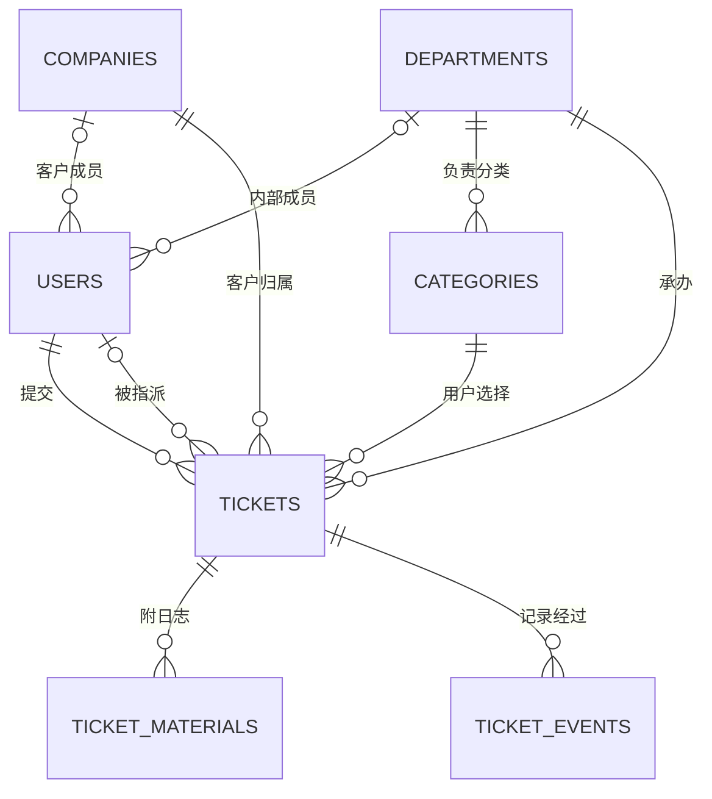

# D1：项目初始化与工单领域建模

阶段：S1 全栈 · W1 数据建模与查询 · 周一 · 2 小时

前置：Node 20.19 及以上、pnpm 10、Git、Docker Desktop（选做的 3.3 用到）。原版初始化脚手架已在 Windows、Node v20.19.6、pnpm 10.28.0 下运行验证，脚手架版本为 create-vite 9.3.4（Vite 8.3.8、Vue 3.5）、@nestjs/cli 12.0.13（NestJS 12），数据库验证用 PostgreSQL 16。

## 今天要做出什么

两件事：

1. **项目初始化（20 分钟）**：建好 `ops-ticket` 仓库，一条 `pnpm dev` 同时启动前后端。后端带上全局校验管道、统一的成功和错误响应格式，并把这些全局配置收进一个函数，让 `main.ts` 和接口测试共用。这些你已经会，教程只给需求清单和参考源码，不讲解。
2. **工单领域建模（主体）**：把“两家客户向同一运维部门报障，Agent 排查，按需转人工，提单人验收”这条业务流程，变成一份数据模型文档 `docs/data-model.md`，内容包括实体关系图、工单状态、字段与约束表、设计决策。

今天必交一份能用案例检验的模型文档。数据库实验选做。[D02](D02-PostgreSQL与Prisma迁移.md) 用 Prisma 建表，验证甲乙两家客户共用网络部的样例。

## 今天的目录结构

`★` 是今天手写或修改的文件，`☆` 是选做，其余由脚手架生成、保持原样。

```text
ops-ticket/
├── .gitignore                     ★ 依赖、构建产物、.env
├── package.json                   ★ 根脚本 dev、build、test
├── pnpm-workspace.yaml            ★ 声明 apps/* 和 packages/*
├── pnpm-lock.yaml                   安装时生成，要提交
├── docs/
│   ├── data-model.md              ★ 今天的主要产出：数据模型文档
│   ├── schema-draft.sql           ☆ 用 SQL 草稿验证约束（3.3）
│   └── constraint-probe.sql       ☆ 逐条试探约束的脚本（3.3）
├── apps/
│   ├── web/                         Vue 3 前端，create-vite 生成
│   │   ├── index.html             ★ 改标题和语言
│   │   ├── package.json           ★ 包名 @ops-ticket/web
│   │   ├── vite.config.ts         ★ 端口和 /api 代理
│   │   └── src/
│   │       ├── App.vue            ★ 后端连通状态
│   │       ├── style.css          ★ 全局基础样式
│   │       └── main.ts              未修改
│   └── server/                      NestJS 后端，Nest CLI 生成
│       ├── package.json           ★ 包名 @ops-ticket/server，加 dev 脚本，加校验依赖
│       ├── src/
│       │   ├── main.ts            ★ 启动入口，调用 configureApp
│       │   ├── app.setup.ts       ★ 全部全局配置：前缀、校验管道、响应拦截器、异常过滤器
│       │   ├── common/
│       │   │   ├── response.interceptor.ts  ★ 成功响应包成 { data }
│       │   │   └── http-exception.filter.ts ★ 错误响应统一成 { error: { code, message, details } }
│       │   ├── app.module.ts        未修改
│       │   ├── app.controller.ts  ★ GET /api/health
│       │   ├── app.service.ts     ★ 健康检查数据
│       │   └── app.controller.spec.ts ★ 单元测试
│       └── test/
│           └── app.e2e-spec.ts    ★ 接口测试：成功和 404 的响应结构
└── packages/                        今天不用建，D6 加前后端共享类型
```

## 时间安排


| 环节    | 分钟  | 内容                                 | 必做/选做                 |
| ----- | ---: | ---------------------------------- | --------------------- |
| 开头    | 10  | 第零节环境体检。从 D2 起改为回忆题                | 必做                    |
| 知识点   | 35  | 第一节，四个建模知识点                        | 必做                    |
| 动手    | 55  | 第二节：步骤 1 初始化 20 分钟，步骤 2-4 建模 35 分钟 | 必做                    |
| 自检与提交 | 20  | 第三节                                | 3.1、3.2、3.4 必做；3.3 选做 |


第五节核心面试题、第六节个人建议、第七节拓展知识点都是选做，完整面试题在 [D1 面试题](D01-面试题.md)，周日练。

**超时预案**：到 1 小时 40 分钟还没写完 `data-model.md`，按下面的顺序砍：

1. 跳过 3.3，SQL 验证放到 D2 开头（D2 本来就要启动 PostgreSQL）。
2. 公司、部门、分类三张表先写主键和关系，把时间留给工单约束。
3. 设计决策只写 3 条：当前状态与历史、主键选择、删除策略。

无论砍掉什么，都要完成 3.4 提交，并告诉我砍了哪些。

## 零、环境体检（10 分钟）

```powershell
node --version      # 需要 v20.19 或更高
pnpm --version      # 需要 10.x
git --version
git config user.name; git config user.email    # 提交前必须设置好
docker --version    # 选做的 3.3 和明天 D2 要用
Get-NetTCPConnection -State Listen -LocalPort 3000, 5173 -ErrorAction SilentlyContinue   # 没有输出就是端口空闲
```

<details class="orca-details">
<summary>版本或端口不满足时怎么办</summary>

- Node 版本低：用 nvm-windows 安装并切换，例如 `nvm install 22` 后 `nvm use 22`。Vite 8 要求 Node 20.19 或更高。
- 没有 pnpm：`corepack enable`，再 `corepack prepare pnpm@10.28.0 --activate`。
- Git 用户名没设：`git config --global user.name "你的名字"`，`git config --global user.email "你的邮箱"`。
- 端口被占用：看输出里的 `OwningProcess` 是哪个进程，确认是你自己之前开的再关掉，不要随手结束不认识的进程。

</details>

## 一、知识点讲解与示例（35 分钟）

### 1.1 从一次报障找到实体和角色

甲公司小林注册时选择甲公司，甲公司的管理员审批后，他提交“客户端一直连接超时”，选择“网络”分类并附一段日志。乙公司小吴也报网络问题。运维公司把这个分类交给网络部。一天下来，甲公司管理员应看到一张工单，网络部负责人可以看到两家客户转来的单，却只能把任务派给内部运维人员。

圈出能独立标识的名词。客户公司、运维部门、分类、用户和工单都需要标识。每份日志属于一张工单，每次提交处理结果或反馈也属于一张工单。客户管理员、负责人、处理人是用户承担的角色。公司管理员账号由运维公司发放。第三方人员按获批公司身份提单。只有原提单人能验收自己的工单。

**推导题**　甲、乙共享网络部，能否用部门编号推断工单属于哪家客户？

<details><summary>展开参考答案</summary>

两张单的部门编号相同，客户却不同。保留两个独立关系：工单归属客户公司，承办部门由用户选择的问题分类确定。日志里的设备名可以是排查线索，无需因此另建一张单。

</details>

### 1.2 用外键表达关系和归属

从“一张单”往外读：它有一个提单人、一个分类和一个承办部门，人工介入前可以没有处理人。转人工时，同一条工单记录增加处理人，原问题和材料仍然可查。从“一份日志”往回读：一张单可以有多份日志，因此 `ticket_id` 放在材料表。同理，处理记录带工单外键，便于按时间还原过程。删除策略取 RESTRICT，防止删除被引用的工单而留下孤立材料。

**推导题**　用户和处理人都在用户表里，为什么工单上要留两个用户外键？

<details><summary>展开参考答案</summary>

`reporter_id` 回答谁报障、谁验收；`assignee_id` 回答当前由谁处理。把两者混在一起，派单就会覆盖提单人，用户点击“未解决”时也找不回原处理人。

</details>

### 1.3 区分行约束、动作与历史

`handled` 表示处理人已提交结果，`reviewed` 表示负责人已复核，`completed` 表示提单人已确认解决。一张工单若是人工已处理，就必须有处理人，这是检查当前行能判断的约束。某人是否有权复核、工单能否从原状态走到目标状态，则要比较执行人和前态。后续在同一事务中改状态并追加事件；今天先写明该由哪一层负责。

**推导题**　小林采纳了 Agent 的建议，未经过人工派单。他点“已解决”时，能给 `completed` 加“必须有处理人”的约束吗？

<details><summary>展开参考答案</summary>

这会挡住合理的完成路径。已完成必须有完成时间；人工处理中、已处理、已复核必须有处理人。通过处理事件可以区分两种解决路径。知识草稿审核属于后续发布流程，用户确认时工单已经完成。

</details>

### 1.4 字段类型的几个关键决策

**主键用什么**：


| 方案               | 优点                              | 缺点                                                  |
| ---------------- | ------------------------------- | --------------------------------------------------- |
| 自增整数             | 小、快、按插入顺序排列，索引写入效率高             | 暴露业务量（单号 10035 说明你大概有一万张单）；接口里可以按顺序遍历；合并多个系统的数据时会冲突 |
| UUID v4（完全随机）    | 全局唯一，可以在应用里生成，不暴露信息             | 16 字节，比整数大；完全随机，大量插入时索引页频繁分裂，写入变慢                   |
| UUID v7（前半段是时间戳） | 保留 UUID 的优点，又大致按时间递增，索引写入接近自增整数 | 能从 ID 里看出大致的创建时间                                    |
| 雪花 ID（64 位整数）    | 小、有序、分布式生成                      | 要正确分配机器号、处理时钟回拨，自研很容易出事故                            |


工单系统选 UUID 作主键，D2 用 Prisma 生成 UUID v7（D2 实测确认 Prisma 当前版本的写法）。另外单独设一个 `ticket_no` 字段给人看。**主键只负责唯一标识，不夹带业务含义**：编号的格式以后可以随意调整，不会影响任何外键。

**时间用 `timestamptz`**。PostgreSQL 的 `timestamptz` 按 UTC 存储，读取时按连接的时区显示；`timestamp` 不带时区，服务器和数据库时区不一致时，SLA 超时的计算就会差几个小时。

**本课工单状态用 `varchar` 加 CHECK**，不用 PostgreSQL 的 `enum` 类型，也不单独建一张状态表。取值只有几个、很少变化，增加一个取值只需要改约束；`enum` 类型要用 `ALTER TYPE`，删除一个取值更麻烦。单独建表只在状态需要存额外属性（例如显示颜色、排序）时才值得。

**推导题 1.4**　负责人今天复核，用户明天确认，`completed_at` 应写哪一天？

<details><summary>展开参考答案</summary>

写用户确认的时间。负责人的复核时间由复核事件记录。两个动作相隔一晚，分开存才能算出等待用户验收的时间。

</details>

## 二、动手开发（55 分钟）

代码和文档都自己写，可以查官方文档，不让 AI 生成。步骤 2-4 卡住时，按顺序展开提示：提示 1 给方向，提示 2 给关键点，提示 3 给骨架。三级都看过仍然写不出来，再看第四节的参考答案。提交时告诉我每一步看到了第几级提示。

### 步骤 1：项目初始化（20 分钟）

这一步你已经会，按清单做，参考源码在第四节。

**命令**：

```powershell
New-Item -ItemType Directory D:\demo\ops-ticket, D:\demo\ops-ticket\apps, D:\demo\ops-ticket\docs
Set-Location D:\demo\ops-ticket
git init
# 根目录写好 package.json、pnpm-workspace.yaml、.gitignore 后：
Set-Location apps
pnpm create vite@9.3.4 web --template vue-ts --no-interactive
pnpm dlx @nestjs/cli@12.0.13 new server --skip-git --skip-install --package-manager pnpm --strict
Set-Location ..
pnpm install
pnpm --filter @ops-ticket/server add class-validator class-transformer
```

`pnpm --filter` 按包名找包，所以要先把 `apps/server/package.json` 的 `name` 改成 `@ops-ticket/server`，再执行最后一条命令。

**清单**：

- [ ] 根 `package.json`：`private: true`；`dev` 用 `--parallel` 同时启动 apps 下所有包；不放任何依赖。
- [ ] `.gitignore` 忽略 `.env` 和 `.env.*`，但放出 `.env.example`。
- [ ] 两个包名改成 `@ops-ticket/web`、`@ops-ticket/server`；后端加 `dev` 脚本（`nest start --watch`）。
- [ ] 删除前端模板的示例组件和图片（`src/components/HelloWorld.vue`、`src/assets/` 下三张图、`public/icons.svg`）。
- [ ] 后端新建 `src/app.setup.ts`，导出 `configureApp(app)`，里面做四件事：全局前缀 `api`；全局 `ValidationPipe`（`whitelist`、`forbidNonWhitelisted`、`transform` 都打开）；全局响应拦截器，把成功结果包成 `{ data }`；全局异常过滤器，把所有错误统一成 `{ error: { code, message, details? } }`，未知异常只返回“服务器内部错误”，堆栈写日志。
- [ ] `main.ts` 和 `test/app.e2e-spec.ts` 都调用 `configureApp`，不在两处分别写配置。
- [ ] 健康检查 `GET /api/health`；接口测试覆盖成功响应和 404 错误响应的结构。
- [ ] 前端 Vite 代理 `/api` 到 `http://localhost:3000`，`strictPort: true`；`App.vue` 显示后端连通状态，读取 `body.data.time`。

完成标准：`pnpm dev` 后，浏览器 `http://localhost:5173` 显示“后端已连接”；`pnpm test` 和 `pnpm --filter @ops-ticket/server test:e2e` 全部通过。

<details class="orca-details">
<summary>常见问题</summary>

- 后端报 `TS2307: Cannot find module './app.module'`：NestJS 12 生成的是 ESM 项目，相对路径的 import 必须写 `.js` 后缀，例如 `./app.setup.js`。
- 接口测试里 `/api/health` 返回 404：测试没有调用 `configureApp`，测试模块不会执行 `main.ts`。
- 启动时报 `The "class-validator" package is missing`：`ValidationPipe` 依赖这两个包，执行清单最后一条命令。
- 生成了 `apps/server/.git`：漏了 `--skip-git`。确认里面没有你的提交后删除它。

</details>

### 步骤 2：画出两家公司和同一承办部门（15 分钟）

手写 `docs/data-model.md`。画一份 ER 图，给每条边写动词，标出处理人可空。把小林和小吴的两张单代入图中，口述甲公司管理员与网络部负责人各按哪个字段查单。

<details><summary>提示 1 · 方向</summary>

先从公司和部门各自出发，看它们分别通过什么关系连到工单。
</details>

<details><summary>提示 2 · 关键点</summary>

公司来自注册获批的用户，部门来自问题分类。检查分类、提单人、处理人及日志的基数。
</details>

<details><summary>提示 3 · 骨架</summary>

先画 `COMPANIES ||--o{ TICKETS` 与 `DEPARTMENTS ||--o{ TICKETS`，再补用户的两条角色边、分类、材料及多条历史事件。
</details>

### 步骤 3：写状态表与字段约束（15 分钟）

为每条边填“起点、谁做什么、结果、下一位操作者”。至少覆盖 Agent 给出有效方案、无法处理后用户申请人工、已复核后用户反馈未解决。列三类字段检查，用一个合法但容易被误拒的例子检验它们。

<details><summary>提示 1 · 方向</summary>

沿着“用户下一步能点什么”读表。在 Agent 提示无法解决时暂停，此刻负责人还没有待办。
</details>

<details><summary>提示 2 · 关键点</summary>

有方案时用户点“未解决”直接转人工。人工复核后再点“未解决”回原处理人。区分这两个同名动作的前态。
</details>

<details><summary>提示 3 · 骨架</summary>

先写 `awaiting_feedback → pending_assignment` 和 `reviewed → human_processing`，再补执行人、处理人是否保留以及事件记录。分别写出编号唯一、人工状态需要处理人、已完成需要时间的规则。
</details>

### 步骤 4：写三项设计决策（5 分钟）

说明为何留两个归属、为何分开当前状态和历史、为何外键无法替代操作人检查。每条决策写一个具体后果。

<details><summary>提示 1 · 方向</summary>

从两家客户共用一个部门的例子开始。
</details>

<details><summary>提示 2 · 关键点</summary>

试着只读当前状态，回答“用户上次为什么退回”。
</details>

<details><summary>提示 3 · 骨架</summary>

“如果只存 ____ ，查询 ____ 会得到 ____ ；我用 ____ 记录这件事。”把三个空换成实际字段和动作。
</details>

## 三、自检与提交（20 分钟）

### 3.1 初始化验证

`pnpm dev` 保持运行，另开一个终端：


| #   | 操作                                                                                        | 预期结果                                                                   |
| ---: | ----------------------------------------------------------------------------------------- | ---------------------------------------------------------------------- |
| 1   | `curl.exe -s http://localhost:5173/api/health`                                            | `{"data":{"status":"ok","service":"ops-ticket-server","time":"..."}}`  |
| 2   | `curl.exe -s http://localhost:5173/api/not-exist`                                         | `{"error":{"code":"NOT_FOUND","message":"Cannot GET /api/not-exist"}}` |
| 3   | 浏览器打开 `http://localhost:5173`                                                             | 后端已连接，带服务器时间                                                           |
| 4   | 停掉 `pnpm dev`，在根目录执行 `pnpm build`、`pnpm test`、`pnpm --filter @ops-ticket/server test:e2e` | 两个包构建成功；单元测试 1 个、接口测试 2 个通过                                            |


### 3.2 用业务样例检验模型

先遮住参考答案，在自己的图、字段表或状态表上指出依据。第 4 题需要同时解释数据库和服务层的行为。

| # | 自检场景 |
|---|---|
| 1 | 甲乙各有一张单，同属网络部。如何让客户管理员只看到本公司？ |
| 2 | Agent 无法处理，用户尚未点击按钮。负责人此时能派单吗？ |
| 3 | 已复核后用户点“未解决”，应回到谁？ |
| 4 | 直接把刚建的单写成已复核，同时填入一个存在的处理人。行约束会报错吗？ |
| 5 | 提单人确认 Agent 建议有效，工单没有处理人。完成条件是什么？ |

<details><summary>展开参考答案</summary>

1. 按 `company_id` 限定公司。部门视图另按 `department_id` 和待办状态过滤，查询层执行范围检查。
2. 当前为 `handoff_offered`。等提单人点击“人工接入”才进 `pending_assignment`。模型给出建议后用户点“未解决”也能直接进待派单。
3. 保留 `assignee_id` 退回原处理人。处理人再次提交后，仍需部门负责人复核和提单人验收。
4. 当前行字段合法，库可以接受。服务端必须检查前态和本部门负责人身份，记录复核事件。
5. 原提单人从等待验证建议的状态确认，记录完成时间和确认事件；知识发布另行审核。
</details>

### 3.3 选做：在 PostgreSQL 16 验证五个判断

把 4.5 两段 SQL 分别保存到 `docs` 下。在 Docker 已启动的环境运行下列命令。容器仅用于本次实验，`pg_isready` 显示接受连接后再执行 psql。第 5 项故意写入非法跳步来观察 CHECK 的能力边界，脚本末尾回滚样例。

```powershell
$labDocs = (Resolve-Path ./docs).Path
$labBox = docker run --rm -d --network none --mount "type=bind,source=$labDocs,target=/sql,readonly" -e POSTGRES_HOST_AUTH_METHOD=trust postgres:16-alpine
docker exec $labBox pg_isready -U postgres
docker exec $labBox psql -X -U postgres -v ON_ERROR_STOP=1 -f /sql/schema-draft.sql -f /sql/constraint-probe.sql
docker stop $labBox
```

预期看到五条 NOTICE：公司和部门查到的单数分别为一和二；缺处理人的“已处理”遭拒；采纳 Agent 建议可直接完成；已完成却缺少完成时间遭拒；直接跳到已复核能穿过行约束。

### 3.4 提交并交给我批改

提交可启动的脚手架和 `docs/data-model.md`。模型要有 ER 图、状态与动作表、字段约束表和三条设计决策。附上 3.2 第 4 题的解释，注明用了哪级提示、是否做 SQL 选做题以及实际耗时。说“D01 提交了”后按实际改动批改，并逐题追问。

## 四、本章完整源码

路径都相对于仓库根目录 `ops-ticket/`。先自己写完再对照。依赖的版本号以你生成时为准，脚手架更新后可能比这里新。

下列文件由脚手架生成、今天没有修改，不再列出：`apps/server` 下的 `tsconfig.json`、`tsconfig.build.json`、`nest-cli.json`、`vitest.config.ts`、`vitest.config.e2e.ts`、`.oxlintrc.json`、`.prettierrc`、`.gitattributes`、`src/app.module.ts`；`apps/web` 下的 `tsconfig.json`、`tsconfig.app.json`、`tsconfig.node.json`、`src/main.ts`、`.gitignore`。

### 4.1 根目录

**.gitignore**

```text
# 依赖与构建产物
node_modules/
dist/
coverage/

# 本机环境变量，可能包含密钥，绝不提交；只提交 .env.example
.env
.env.*
!.env.example

# 日志与系统文件
*.log
.DS_Store
```

**package.json**

```json
{
  "name": "ops-ticket",
  "private": true,
  "packageManager": "pnpm@10.28.0",
  "engines": {
    "node": ">=20.19"
  },
  "scripts": {
    "dev": "pnpm --parallel --filter \"./apps/*\" dev",
    "build": "pnpm --recursive --filter \"./apps/*\" build",
    "test": "pnpm --filter @ops-ticket/server test"
  }
}
```

**pnpm-workspace.yaml**

```yaml
# 声明哪些目录是工作区里的包：apps 放可运行的应用，packages 放被应用共享的库
packages:
  - apps/*
  - packages/*
```

### 4.2 后端 apps/server

**apps/server/package.json**

```json
{
  "name": "@ops-ticket/server",
  "version": "0.0.1",
  "description": "",
  "author": "",
  "private": true,
  "license": "UNLICENSED",
  "type": "module",
  "scripts": {
    "build": "nest build",
    "deploy": "nest deploy",
    "format": "prettier --write \"src/**/*.ts\" \"test/**/*.ts\"",
    "start": "nest start",
    "start:dev": "nest start --watch",
    "dev": "nest start --watch",
    "start:debug": "nest start --debug --watch",
    "start:prod": "node dist/main",
    "lint": "oxlint --type-aware src/ test/",
    "test": "vitest run",
    "test:watch": "vitest",
    "test:cov": "vitest run --coverage",
    "test:debug": "vitest --inspect-brk --no-file-parallelism",
    "test:e2e": "vitest run --config ./vitest.config.e2e.ts"
  },
  "dependencies": {
    "@nestjs/common": "^12.0.1",
    "@nestjs/core": "^12.0.1",
    "@nestjs/platform-express": "^12.0.1",
    "class-transformer": "^0.5.1",
    "class-validator": "^0.15.1",
    "reflect-metadata": "^0.2.2",
    "rxjs": "^7.8.1"
  },
  "devDependencies": {
    "@nestjs/cli": "^12.0.0",
    "@nestjs/mau": "^0.2.6",
    "@nestjs/schematics": "^12.0.0",
    "@nestjs/testing": "^12.0.1",
    "@types/express": "^5.0.0",
    "@types/node": "^24.0.0",
    "@types/supertest": "^7.0.0",
    "@vitest/coverage-v8": "^4.1.2",
    "oxlint": "^1.58.0",
    "oxlint-tsgolint": "^7.0.2001",
    "prettier": "^3.4.2",
    "source-map-support": "^0.5.21",
    "supertest": "^7.0.0",
    "typescript": "^6.0.2",
    "vite": "^8.0.0",
    "vitest": "^4.1.2"
  }
}
```

**apps/server/src/main.ts**

```ts
import { Logger } from '@nestjs/common';
import { NestFactory } from '@nestjs/core';
import { configureApp } from './app.setup.js';
import { AppModule } from './app.module.js';

async function bootstrap() {
  const app = await NestFactory.create(AppModule);
  configureApp(app);

  // 收到 Ctrl+C 等退出信号时，让 Nest 走完生命周期钩子再退出（以后关闭数据库连接要用到）
  app.enableShutdownHooks();

  const port = Number(process.env.PORT ?? 3000);
  await app.listen(port);
  Logger.log(`后端已启动：http://localhost:${port}/api/health`, 'Bootstrap');
}
await bootstrap();
```

**apps/server/src/app.setup.ts**

```ts
import { type INestApplication, ValidationPipe } from '@nestjs/common';
import { HttpExceptionFilter } from './common/http-exception.filter.js';
import { ResponseInterceptor } from './common/response.interceptor.js';

// 所有全局配置集中在这里，main.ts 和接口测试调用同一个函数，两边不会不一致
export function configureApp(app: INestApplication): void {
  app.setGlobalPrefix('api');
  app.useGlobalPipes(
    new ValidationPipe({
      whitelist: true, // 去掉 DTO 里没声明的字段
      forbidNonWhitelisted: true, // 多传字段直接 400，而不是悄悄忽略
      transform: true, // 把参数转成 DTO 类型，例如字符串 '1' 转成数字 1
    }),
  );
  app.useGlobalInterceptors(new ResponseInterceptor());
  app.useGlobalFilters(new HttpExceptionFilter());
}
```

**apps/server/src/common/response.interceptor.ts**

```ts
import {
  CallHandler,
  ExecutionContext,
  Injectable,
  NestInterceptor,
} from '@nestjs/common';
import { map, type Observable } from 'rxjs';

// 成功响应统一包一层 data，前端只按一种结构解析
export interface SuccessBody<T> {
  data: T;
}

@Injectable()
export class ResponseInterceptor<T>
  implements NestInterceptor<T, SuccessBody<T>>
{
  intercept(
    _context: ExecutionContext,
    next: CallHandler<T>,
  ): Observable<SuccessBody<T>> {
    return next.handle().pipe(map((data) => ({ data })));
  }
}
```

**apps/server/src/common/http-exception.filter.ts**

```ts
import {
  ArgumentsHost,
  Catch,
  ExceptionFilter,
  HttpException,
  HttpStatus,
  Logger,
} from '@nestjs/common';
import type { Response } from 'express';

// 错误响应统一结构：code 给程序判断，message 给人看，details 放校验失败的字段
export interface ErrorBody {
  error: { code: string; message: string; details?: unknown };
}

@Catch()
export class HttpExceptionFilter implements ExceptionFilter {
  private readonly logger = new Logger(HttpExceptionFilter.name);

  catch(exception: unknown, host: ArgumentsHost) {
    const response = host.switchToHttp().getResponse<Response>();

    if (exception instanceof HttpException) {
      const status = exception.getStatus();
      const raw = exception.getResponse();
      // ValidationPipe 抛出的 400，message 是字段错误数组，放进 details
      const message =
        typeof raw === 'object' && raw !== null && 'message' in raw
          ? (raw as { message: unknown }).message
          : exception.message;
      const body: ErrorBody = {
        error: {
          code: HttpStatus[status] ?? 'HTTP_ERROR',
          message: Array.isArray(message) ? '请求参数不合法' : String(message),
          ...(Array.isArray(message) ? { details: message } : {}),
        },
      };
      response.status(status).json(body);
      return;
    }

    // 未知异常：完整堆栈只写日志，不返回给客户端，避免泄露内部信息
    this.logger.error(exception instanceof Error ? exception.stack : exception);
    const body: ErrorBody = {
      error: { code: 'INTERNAL_SERVER_ERROR', message: '服务器内部错误' },
    };
    response.status(HttpStatus.INTERNAL_SERVER_ERROR).json(body);
  }
}
```

**apps/server/src/app.service.ts**

```ts
import { Injectable } from '@nestjs/common';

// 健康检查返回的数据结构
export interface HealthStatus {
  status: 'ok';
  service: string;
  time: string;
}

@Injectable()
export class AppService {
  // 只说明“进程活着并能处理请求”；以后接入数据库后再补依赖检查
  getHealth(): HealthStatus {
    return {
      status: 'ok',
      service: 'ops-ticket-server',
      time: new Date().toISOString(),
    };
  }
}
```

**apps/server/src/app.controller.ts**

```ts
import { Controller, Get } from '@nestjs/common';
import { AppService, type HealthStatus } from './app.service.js';

@Controller()
export class AppController {
  // 构造函数参数由 Nest 的依赖注入容器自动创建并传入
  constructor(private readonly appService: AppService) {}

  // 加上全局前缀后，完整路径是 GET /api/health
  @Get('health')
  getHealth(): HealthStatus {
    return this.appService.getHealth();
  }
}
```

**apps/server/src/app.controller.spec.ts**

```ts
import { Test, TestingModule } from '@nestjs/testing';
import { AppController } from './app.controller.js';
import { AppService } from './app.service.js';

describe('AppController', () => {
  let appController: AppController;

  beforeEach(async () => {
    // 用测试模块装配控制器和服务，和真实运行时的依赖注入方式一致
    const app: TestingModule = await Test.createTestingModule({
      controllers: [AppController],
      providers: [AppService],
    }).compile();

    appController = app.get<AppController>(AppController);
  });

  describe('health', () => {
    it('返回 ok 状态和服务名', () => {
      const health = appController.getHealth();
      expect(health.status).toBe('ok');
      expect(health.service).toBe('ops-ticket-server');
      // 时间必须是合法的 ISO 字符串
      expect(new Date(health.time).toISOString()).toBe(health.time);
    });
  });
});
```

**apps/server/test/app.e2e-spec.ts**

```ts
import { Test, TestingModule } from '@nestjs/testing';
import { INestApplication } from '@nestjs/common';
import request from 'supertest';
import { App } from 'supertest/types.js';
import { AppModule } from './../src/app.module.js';
import { configureApp } from './../src/app.setup.js';

describe('全局配置 (e2e)', () => {
  let app: INestApplication<App>;

  beforeEach(async () => {
    const moduleFixture: TestingModule = await Test.createTestingModule({
      imports: [AppModule],
    }).compile();

    app = moduleFixture.createNestApplication();
    // 和 main.ts 调用同一个函数，前缀、管道、拦截器、过滤器与线上一致
    configureApp(app);
    await app.init();
  });

  it('GET /api/health 成功响应包在 data 里', () => {
    return request(app.getHttpServer())
      .get('/api/health')
      .expect(200)
      .expect((res) => {
        expect(res.body.data.status).toBe('ok');
      });
  });

  it('不存在的路径返回统一的错误结构', () => {
    return request(app.getHttpServer())
      .get('/api/not-exist')
      .expect(404)
      .expect((res) => {
        expect(res.body.error.code).toBe('NOT_FOUND');
        expect(typeof res.body.error.message).toBe('string');
      });
  });

  afterEach(async () => {
    await app.close();
  });
});
```

### 4.3 前端 apps/web

**apps/web/package.json**

```json
{
  "name": "@ops-ticket/web",
  "private": true,
  "version": "0.0.0",
  "type": "module",
  "scripts": {
    "dev": "vite",
    "build": "vue-tsc -b && vite build",
    "preview": "vite preview"
  },
  "dependencies": {
    "vue": "^3.5.44"
  },
  "devDependencies": {
    "@types/node": "^24.19.2",
    "@vitejs/plugin-vue": "^6.0.10",
    "@vue/tsconfig": "^0.9.1",
    "typescript": "~6.0.3",
    "vite": "^8.3.6",
    "vue-tsc": "^3.3.14"
  }
}
```

**apps/web/index.html**

```html
<!doctype html>
<html lang="zh-CN">
  <head>
    <meta charset="UTF-8" />
    <link rel="icon" type="image/svg+xml" href="/favicon.svg" />
    <meta name="viewport" content="width=device-width, initial-scale=1.0" />
    <title>智能运维工单系统</title>
  </head>
  <body>
    <div id="app"></div>
    <script type="module" src="/src/main.ts"></script>
  </body>
</html>
```

**apps/web/vite.config.ts**

```ts
import vue from '@vitejs/plugin-vue'
import { defineConfig } from 'vite'

// https://vite.dev/config/
export default defineConfig({
  plugins: [vue()],
  server: {
    port: 5173,
    // 端口被占用时直接报错，而不是悄悄换端口，避免“页面开着旧端口”的困惑
    strictPort: true,
    proxy: {
      // 浏览器请求 /api/* 时，由 Vite 开发服务器转发给后端，页面和接口同源，不需要 CORS
      '/api': 'http://localhost:3000',
    },
  },
})
```

**apps/web/src/App.vue**

```vue
<script setup lang="ts">
import { onMounted, ref } from 'vue'

// 后端连通状态：检查中、已连接、连接失败
type BackendState =
  | { status: 'checking' }
  | { status: 'ok'; time: string }
  | { status: 'error'; message: string }

const backend = ref<BackendState>({ status: 'checking' })

async function checkBackend() {
  backend.value = { status: 'checking' }
  try {
    // 相对路径，请求先到 Vite 开发服务器，再被代理到 http://localhost:3000
    const response = await fetch('/api/health')
    if (!response.ok) {
      // fetch 收到 4xx/5xx 不会抛异常，要自己检查状态码
      backend.value = { status: 'error', message: `HTTP ${response.status}` }
      return
    }
    // 后端统一把成功结果包在 data 里
    const body: { data: { status: string; time: string } } = await response.json()
    backend.value = { status: 'ok', time: body.data.time }
  } catch (error) {
    // 走到这里是网络层失败，例如开发服务器本身没启动
    backend.value = { status: 'error', message: String(error) }
  }
}

onMounted(checkBackend)
</script>

<template>
  <main>
    <h1>智能运维工单系统</h1>
    <section class="card">
      <p v-if="backend.status === 'checking'">正在检查后端…</p>
      <p v-else-if="backend.status === 'ok'" class="ok">后端已连接，服务器时间 {{ backend.time }}</p>
      <p v-else class="error">后端连接失败：{{ backend.message }}</p>
      <button type="button" @click="checkBackend">重新检查</button>
    </section>
  </main>
</template>

<style scoped>
.card { max-width: 480px; padding: 16px 20px; background: #fff; border: 1px solid #d0d7de; border-radius: 8px; }
.ok { color: #1a7f37; }
.error { color: #cf222e; }
</style>
```

**apps/web/src/style.css**

```css
/* 全局基础样式：只放字体、颜色和页面边距，组件样式写在各自的组件里 */
:root {
  font-family: system-ui, 'Microsoft YaHei', sans-serif;
  color: #1f2328;
  background: #f6f8fa;
}

body {
  margin: 0;
  padding: 32px;
}
```

### 4.4 参考答案 · docs/data-model.md

先提交自己的推导，再对照这份模型检查是否漏了归属、前态或执行人。

````markdown
# 客户服务工单数据模型

甲、乙两家公司都由运维公司的网络部服务。甲公司小林提交“网络中断”，附上一段日志。乙公司同样能向网络部报障。查询“本公司的工单”按客户公司过滤，查询“网络部待派单”按承办部门和状态过滤。部门负责人可以服务两家公司，客户管理员只审批本公司注册和查看本公司工单。

## 实体与关系



客户与第三方提单人按获批所属公司使用系统。内部运维人员属于运维部门。在 USERS 一端，每张工单有一位提单人、零或一位处理人。图中的两种成员关系对单个用户均可选，客户账号只关联客户公司，内部账号只关联运维部门。

## 工单状态与动作

| 当前状态 | 动作和执行者 | 下一状态 |
|---|---|---|
| 尚未建单 | 已获批用户提交分类、描述，可附日志 | agent_processing（Agent 排查中） |
| agent_processing | Agent 分析意图、日志和可检索资料，给出可验证步骤 | awaiting_feedback（待用户验证建议） |
| agent_processing | Agent 无法处理，向用户显示人工接入入口 | handoff_offered（待用户选择人工接入） |
| handoff_offered | 提单人点击“人工接入” | pending_assignment（部门负责人待派单） |
| awaiting_feedback | 提单人点击“未解决” | pending_assignment |
| awaiting_feedback | 提单人点击“已解决” | completed（已完成） |
| pending_assignment | 分类对应部门的负责人指派本部门内部运维 | human_processing（人工处理中） |
| human_processing | 原处理人提交处理结果 | handled（已处理，待部门负责人复核） |
| handled | 负责人复核通过，通知提单人 | reviewed（已复核，待提单人验收） |
| handled | 负责人复核退回，记录理由（本课设计约定） | human_processing，保留原处理人 |
| reviewed | 提单人点击“未解决” | human_processing，保留原处理人 |
| reviewed | 提单人点击“已解决” | completed |

知识草稿在工单完成后另行送审，由运维部门负责人审核后才能成为共享资料。工单状态与知识条目状态分别建模。今天只标出这个分界，知识发布在后续章节实现。

## 字段与约束

| 表 | 字段或约束 | 解决的问题 |
|---|---|---|
| companies、departments | id 为主键，name 必填 | 客户公司和运维部门是两种独立归属 |
| users | id、company_id 或 department_id、role、registration_status | 区分普通提单人、客户管理员、负责人和处理人；账号作用范围由后端复核 |
| categories | id、name、department_id 外键 | 按用户选择的分类确定部门 |
| tickets | id（UUID）、ticket_no（唯一）、company_id、reporter_id、category_id、department_id、description（非空白）、status | 服务端从获批账号取客户公司、从分类取承办部门，保存提交时的归属 |
| tickets | assignee_id 可空；人工处理中、已处理、已复核必须有处理人 | Agent 直接解决的单可以在没有人工处理人的情况下完成 |
| tickets | created_at、completed_at 为 timestamptz；已完成必须有完成时间，其他状态完成时间为空 | 复核时间记录在事件里，用户验收时间另存 |
| ticket_materials | id、ticket_id、日志文本或存储引用 | 一张单可无日志，也可附多份材料。访问材料继承工单的可见范围 |
| ticket_events | id、ticket_id、动作、操作者来源、actor_id、前后状态、说明、created_at | 追加记录可回溯谁提单、谁复核、谁要求返工。Agent 的动作使用系统来源，人类动作保留用户标识 |

## 设计决策

1. 主键用于关联，业务编号用于用户沟通。状态与追加的处理历史分开，查当前负责人待办只查当前行，复盘退回原因查事件。
2. 分类到部门按提交时的映射取值。后续分类配置发生变化时，历史工单仍指向当时的承办部门。
3. 外键采用 RESTRICT 保护引用。外键证明对象存在。服务层验证账号、角色、数据范围和允许的前后状态，在同一事务里改工单并追加事件。
4. reviewed 退回时沿用 assignee_id。用户直接采纳 Agent 建议时可从 awaiting_feedback 完成；要求所有完成单都有处理人，会把这条正常路径挡住。
````

### 4.5 选做实验的完整 SQL

这份最小草稿只建第三节验证所需的列。身份、日志访问和状态流转的运行时校验在后续章节实现。

**docs/schema-draft.sql**

```sql
-- D01 约束实验，只抽取关系图中用于验证的字段。事务由试探脚本控制。
CREATE TABLE companies (id integer PRIMARY KEY);
CREATE TABLE departments (id integer PRIMARY KEY);
CREATE TABLE categories (
  id integer PRIMARY KEY,
  department_id integer NOT NULL REFERENCES departments ON DELETE RESTRICT
);
CREATE TABLE users (
  id integer PRIMARY KEY,
  company_id integer REFERENCES companies ON DELETE RESTRICT,
  department_id integer REFERENCES departments ON DELETE RESTRICT,
  CONSTRAINT users_membership CHECK (num_nonnulls(company_id, department_id) = 1)
);
CREATE TABLE tickets (
  id uuid PRIMARY KEY,
  ticket_no text NOT NULL UNIQUE,
  company_id integer NOT NULL REFERENCES companies ON DELETE RESTRICT,
  reporter_id integer NOT NULL REFERENCES users ON DELETE RESTRICT,
  category_id integer NOT NULL REFERENCES categories ON DELETE RESTRICT,
  department_id integer NOT NULL REFERENCES departments ON DELETE RESTRICT,
  assignee_id integer REFERENCES users ON DELETE RESTRICT,
  description text NOT NULL CHECK (btrim(description) <> ''),
  status text NOT NULL DEFAULT 'agent_processing' CHECK (status IN (
    'agent_processing','awaiting_feedback','handoff_offered','pending_assignment',
    'human_processing','handled','reviewed','completed'
  )),
  completed_at timestamptz,
  CONSTRAINT tickets_assignee_required CHECK (
    status NOT IN ('human_processing','handled','reviewed') OR assignee_id IS NOT NULL
  ),
  CONSTRAINT tickets_completion_time CHECK ((status = 'completed') = (completed_at IS NOT NULL))
);
CREATE TABLE ticket_materials (
  id integer PRIMARY KEY,
  ticket_id uuid NOT NULL REFERENCES tickets ON DELETE RESTRICT,
  log_text text NOT NULL
);
CREATE TABLE ticket_events (
  id integer PRIMARY KEY,
  ticket_id uuid NOT NULL REFERENCES tickets ON DELETE RESTRICT,
  actor_id integer REFERENCES users ON DELETE RESTRICT,
  action text NOT NULL,
  created_at timestamptz NOT NULL DEFAULT now()
);
```

**docs/constraint-probe.sql**

```sql
-- 独立实验库。成功时输出五行 NOTICE；任何不符预期的结果都会中止。
BEGIN;
INSERT INTO companies VALUES (1),(2);
INSERT INTO departments VALUES (10);
INSERT INTO categories VALUES (100,10);
INSERT INTO users VALUES (1,1,NULL),(2,2,NULL),(3,NULL,10);
INSERT INTO tickets (id,ticket_no,company_id,reporter_id,category_id,department_id,description)
VALUES ('00000000-0000-0000-0000-000000000001','T-001',1,1,100,10,'客户端连接超时'),
       ('00000000-0000-0000-0000-000000000002','T-002',2,2,100,10,'办公室网络中断');
DO $$
DECLARE
  scoped integer;
  dept_total integer;
BEGIN
  SELECT count(*) INTO scoped FROM tickets WHERE company_id = 1;
  SELECT count(*) INTO dept_total FROM tickets WHERE department_id = 10;
  IF scoped <> 1 OR dept_total <> 2 THEN RAISE EXCEPTION '归属计数错误'; END IF;
  RAISE NOTICE '1. 一家公司一张单，运维部门两张单';
  BEGIN
    UPDATE tickets SET status = 'handled' WHERE ticket_no = 'T-001';
    RAISE EXCEPTION '人工已处理却缺处理人';
  EXCEPTION WHEN check_violation THEN
    IF SQLERRM NOT LIKE '%tickets_assignee_required%' THEN RAISE; END IF;
    RAISE NOTICE '2. 已处理缺少处理人被拒绝';
  END;
  UPDATE tickets SET status = 'awaiting_feedback' WHERE ticket_no = 'T-001';
  UPDATE tickets SET status = 'completed', completed_at = now() WHERE ticket_no = 'T-001';
  RAISE NOTICE '3. 采纳 Agent 建议可无人工作业完成';
  BEGIN
    UPDATE tickets SET completed_at = NULL WHERE ticket_no = 'T-001';
    RAISE EXCEPTION '完成时间丢失';
  EXCEPTION WHEN check_violation THEN
    IF SQLERRM NOT LIKE '%tickets_completion_time%' THEN RAISE; END IF;
    RAISE NOTICE '4. 已完成缺少完成时间被拒绝';
  END;
  UPDATE tickets SET status = 'reviewed', assignee_id = 3 WHERE ticket_no = 'T-002';
  RAISE NOTICE '5. 行约束允许跳到已复核，服务层必须校验前态和执行人';
END $$;
ROLLBACK;
```

## 五、核心面试题（选做，5 分钟）

今天只看下面 3 道，各用一分钟在脑子里过一遍要点。原题、原文答案和其余题目在 [D1 面试题](D01-面试题.md)，周日完整练习。

**1. 全栈开发中，如何设计数据库表结构以应对高频读写？**
来源：《2026美团前端全栈开发》第 1 页，答案在第 9 页。
要点：先讲正确性，再讲性能。按业务实体和关系拆表，当前状态和历史分开；索引只建在高频查询的条件上，并用查询计划证明（D4）；读多的数据加缓存（W4）；冗余字段要说清由谁维护一致性。不要一上来就答读写分离、分库分表，那是数据量很大以后才需要的。

**2. 为什么要用外键？高并发系统为什么有人不用？**
来源：掘金，2025-03-28。
要点：外键让数据库保证“引用的行一定存在”，并决定删除时的行为（RESTRICT、CASCADE、SET NULL）。不用外键的理由是写入时多一次检查，以及分库分表后外键无法跨库。代价是一致性全靠代码，任何一条遗漏的路径都会留下孤儿数据。工单系统选外键加 RESTRICT，因为单库、数据量可控，审计要求高。

**3. 主键用自增 ID、UUID 还是雪花 ID？**
来源：掘金，2025-05-22（一次雪花 ID 重复的线上事故复盘）。
要点：用 1.4 的对比表回答，再说明本项目的选择：UUID v7 作主键，`ticket_no` 单独给人看，主键不夹带业务含义。追问“雪花 ID 有什么风险”时，讲时钟回拨和机器号分配，以及那篇事故里自研实现只保留 31 位时间戳、机器号全为 0 导致的重复。

## 六、个人建议

- **今天的重点在建模，不在初始化**。初始化你闭着眼也能写，严格控制在 20 分钟内，超时就照着第四节写完，把时间留给 `data-model.md`。
- **用前端的经验理解后端的约束**。你写过表单校验：前端校验是为了体验，后端校验是为了安全。数据库约束是第三层，防的是“所有代码都可能有 bug”。三层不是重复，各管一件事。面试被问“前端校验过了，后端为什么还要校验”时，可以顺着讲到数据库约束，这比只答前后端两层更完整。
- **3.2 的第 4 题是今天的分水岭**。分不清“数据库能挡什么、挡不了什么”，W2 写状态机和事务时会反复踩坑。答错了不要紧，进错题本，过几天会复测。
- **全部手写，包括 Mermaid 图**。写 ER 图的过程就是在想清楚关系，让 AI 画就跳过了思考。
- **简历先别写**。等 W2 有了事务和并发测试，再写“设计工单状态模型与数据约束”这一类描述。

## 七、拓展知识点


| 知识点                  | 为什么值得学                                                                                     | 学到什么程度                       | 什么时候用到            |
| -------------------- | ------------------------------------------------------------------------------------------ | ---------------------------- | ----------------- |
| 数据库三大范式与反范式          | 面试常问；能解释为什么不把处理人姓名存在工单表里                                                                   | 能用本项目举例说明第一到第三范式，以及什么情况下故意冗余 | 周日复盘              |
| PostgreSQL 约束的检查时机   | 外键可以设成 `DEFERRABLE`，到事务提交时才检查；CHECK 约束按名称的字母顺序检查                                           | 知道有这两个机制，遇到“为什么报的是另一条约束”时能想到 | W2 写事务时           |
| 组合唯一约束 | 同一提单人网络超时后可能重试 | 能解释为何业务单号唯一与请求幂等要分别设计 | D11 |
| 事件溯源（Event Sourcing） | 今天的“当前状态 + 历史记录”是它的简化版；完整的事件溯源只存事件，当前状态由事件重放得出                                             | 能说清两者的区别和各自的代价，不需要实现         | S5 设计 Agent 运行记录时 |
| UUID v7              | 时间有序的 UUID，PostgreSQL 18 开始内置 `uuidv7()` 函数                                                | 知道它为什么比 v4 对索引友好             | D2                |


## 本文验证范围

本次在独立 PostgreSQL 16 容器执行 4.5 两份 SQL，建表成功，五项试探均符合 3.3 的预期。脚本检验选定的行约束与查询样例。用户权限、状态机、Agent 诊断与知识发布在 D01 以模型和场景推演验收，后续章节再写接口和测试。

初始化代码沿用原版 D01。原版记录为前后端构建、1 个单元测试、2 个接口测试及健康检查通过。本次改版的实测范围为新版 SQL 和教程阅读构建。两小时为计划课时，学员实际用时待提交。
