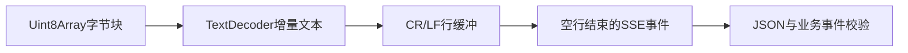

# D44（周二）：SSE协议与增量解析

S2 AI前端 · W7 · 2小时。前置：[D43模型请求契约](D43-模型请求契约与本机验证.md)。沿用Node20.19.6、pnpm10.28.0、TypeScript6.0.3、Vitest4.1.12，无新依赖。本章纯协议与内存流测试，尚未接业务接口。

## 今天要做出什么

把一段包含“超时”的 UTF-8 事件切在汉字中间，再把两个事件合在一个网络块送入解析器。

把网络字节流逐层变成完整SSE事件，确保中文跨块不损坏，多行data不丢换行，EOF半帧不冒充成功。解析器放shared，后端与前端后续共用。

## 今天的目录结构

- `apps/server/src/assistant/sse.spec.ts`
- `packages/shared/src/index.ts`
- `packages/shared/src/sse.ts`

## 时间安排（120分钟）

回忆10 → 知识点35 → 动手55（状态20、读取20、测试15）→ 自检20。必做为UTF-8跨块、行与事件状态、多行data、EOF、两反证。到1小时40分钟先砍选做的随机分块与性能比较；保留真实失败记录和恢复。门禁等待另计。

## 零、开头10分钟：闭卷回忆

**1. D43：为什么要保留length结束原因？**

<details><summary>答案</summary>

HTTP200只说明响应成功传输，length说明生成达到预算；应保留部分文字并提示截断，不能一律标完整完成。

</details>

**2. D41：为什么SSE与普通HTTP耗时分开？**

<details><summary>答案</summary>

长连接结束时间是寿命，不能代表首帧响应时间；普通HTTP延迟和SSE活跃连接分别观察，requestId不做指标标签。

</details>

**3. D37：为什么不能把上游Error.message直接写日志？**

<details><summary>答案</summary>

它可能含地址、认证或业务文本。白名单固定错误码与可控字段才能限制泄漏，JSON格式本身不是脱敏。

</details>

复测[错题本](../学习记录/错题本.md)到期项，不把作者测试当自己的成绩。

## 一、知识点与推导（35分钟）

### 1.1 四层边界，不能混用



一个read可能切在中文的第二个字节，也可能包含三个完整事件。TextDecoder负责字符边界，SseParser负责行和事件；JSON.parse只用于完整事件的data，不对每个read或每一行调用。

下面是协议示例，不是独立执行结果：

```text
event: delta
data: 第一行
data: 第二行

```

完整data为`第一行\n第二行`，末尾空行才分派。没有event时名称为message，注释以冒号开头。这里只消费event/data，id/retry不提供重连能力。[SSE格式与分派规则](https://html.spec.whatwg.org/multipage/server-sent-events.html#event-stream-interpretation)。

**推导题**：收到`data: {"a":`，下一块是`1}\n\n`，第一块能做什么？

<details><summary>答案</summary>

只存入行缓冲；第二块补齐行并出现空行后才得到完整data，再交JSON解析。切块方式由传输决定，不由模型token决定。

</details>

### 1.2 同一个decoder还不够

每次decode(value,{stream:true})保留未完整的UTF-8序列，EOF调用decode()收尾。本项目fatal:true遇到非法或半个字符就报SSE_INVALID_UTF8，选择比EventSource替换字符更严格的应用策略；不能声称与浏览器容错完全一致。[TextDecoder定义](https://encoding.spec.whatwg.org/#interface-textdecoder)。

解析器只跳过开头一个BOM，因此decoder设ignoreBOM:true，把BOM保留给这一层处理，避免两层各吞一个。单帧限制按UTF-16代码单元，总流限制按原始字节，两者都不是token。

**推导题**：把decoder放到while外面，却每次用默认decode(value)，还会错吗？

<details><summary>答案</summary>

会。默认非stream会在块末结束解码，半个中文被当非法序列；反证A在每块一个字节时实际失败。

</details>

### 1.3 CRLF跨块与半帧EOF

遇到CR先结束一行，记住skipLf；下一个字符若是LF只跳过一次。这样同一输入无论从哪里切开都应得到相同事件。遇到空行，分派已有data后重置event/data；无data的空行不发事件，但也清掉event，不能污染下一帧。

EOF不能人为追加空行。`data: lost\n`虽然已有完整data行，仍缺事件分隔；finish丢弃它。至于这是否代表业务失败，需要业务层检查done终止事件，D45/D47再处理。本章解析器的正常返回仅表示字节流结束。

**推导题**：末尾有一个正常delta，之后断线，解析器结束就能显示成功吗？

<details><summary>答案</summary>

不能。SSE只提供事件格式，业务完成另有终止条件；没有终止事件时应保留部分结果并显示中断。

</details>

### 1.4 流式不自动等于内存有界

没有空行时，行缓冲和多行data都可能不断增长。这里单帧预算64Ki代码单元，总输入2MiB；注释也计入预算，不能靠无限心跳绕过。push一次返回数组，所以单个输入块含很多事件时仍会暂存这些事件；总流上限限定了规模，不宣称任意无限流恒定内存。

readSse用异步生成器，finally取消reader并释放锁；消费者break也进入finally。仅releaseLock不会取消底层读取，释放与取消目的不同。D46再把HTTP断开和上游AbortSignal连起来。

**推导题**：每条data都短，但一直没有空行，单行限制够吗？

<details><summary>答案</summary>

不够，多行会堆积。需要累计帧预算，总字节上限则防止大量短事件或注释形成无限消费。

</details>

## 二、动手开发（55分钟）

### 步骤1：写文本状态机（20分钟）

<details><summary>提示1：方向</summary>

保存line、data数组、event、skipLf、first和帧计数，不用split('\n\n')一次解决全部协议。

</details>
<details><summary>提示2：API和位置</summary>

shared/sse.ts导出SseParser。冒号前是字段，后面只去一个可选空格；无冒号视为值为空。

</details>
<details><summary>提示3：骨架</summary>

逐字符→BOM与skipLf→遇换行处理line→空行分派→否则解析field/value→非换行累加line和预算。data.join('\n')保留行结构。

</details>

### 步骤2：写字节流适配（20分钟）

<details><summary>提示1：方向</summary>

解析器不依赖浏览器或Nest；readSse负责读取、解码、总字节限制和资源释放。

</details>
<details><summary>提示2：关键API</summary>

AsyncGenerator、ReadableStream.getReader、TextDecoder、yield*。异常使用固定错误码，不拼入收到的data。

</details>
<details><summary>提示3：骨架</summary>

try里循环read→累计字节→decode(stream:true)→parser.push→yield事件；EOF flush decoder后finish；finally cancel和releaseLock。

</details>

### 步骤3：用分块不变性验证（15分钟）

<details><summary>提示1：方向</summary>

同一串UTF-8输入枚举每个双块切分位置，预期事件固定；额外每字节一块，捕获decoder重置问题。

</details>
<details><summary>提示2：测试API</summary>

TextEncoder生成bytes，slice构造分块，ReadableStream提供队列。先build shared再测试，否则会读旧dist。

</details>
<details><summary>提示3：断言</summary>

除了中文和CRLF，测试多行、空data、注释、未知字段、EOF半帧、双BOM、超限、非法字节和break取消。不要只数事件个数，还要核对data原文。

</details>

```powershell
pnpm --filter @ops-ticket/shared build
pnpm --filter @ops-ticket/server test src/assistant/sse.spec.ts
pnpm run ci
```

常见问题：修改shared后每个反证的基线、故障、复测都要重建，作者的反证工具已经这样执行。不要因旧dist测试通过误判源码正确。

## 三、自检、反证与提交

删掉最后一个空行后关闭连接，应当能否交付最后一个完整事件？

先写下预期，临时去掉对应的检查，保存一次失败结果，再恢复并复跑。在提交记录中写明触发操作、预期、实际结果和用时。

## 四、本章完整源码

**apps/server/src/assistant/sse.spec.ts**

```ts
import { appendFileSync } from 'node:fs';
import { readSse, SseParser, type SseFrame } from '@ops-ticket/shared';

const bytes = (text: string) => new TextEncoder().encode(text);
function stream(chunks: Uint8Array[], cancel?: () => void) {
  let index = 0;
  return new ReadableStream<Uint8Array>({ pull(controller) {
    if (index < chunks.length) controller.enqueue(chunks[index++]); else controller.close();
  }, cancel });
}
async function collect(chunks: Uint8Array[], options?: { maxFrameChars?: number; maxBytes?: number }) {
  const result: SseFrame[] = [];
  for await (const event of readSse(stream(chunks), options)) result.push(event);
  return result;
}
const report = (data: object) => {
  if (process.env.D44_EVIDENCE_FILE) appendFileSync(process.env.D44_EVIDENCE_FILE, JSON.stringify(data) + '\n');
};
describe('SSE增量解析（D44）', () => {
  it('所有双块切分位置都保留中文和CRLF事件', async () => {
    const input = bytes('\uFEFF:心跳\r\nevent: delta\r\ndata: 中文🙂\r\ndata: 第二行\r\n\r\ndata: tail\n\n');
    const expected = [{ event: 'delta', data: '中文🙂\n第二行' }, { event: 'message', data: 'tail' }];
    for (let cut = 0; cut <= input.length; cut++) expect(await collect([input.slice(0, cut), input.slice(cut)])).toEqual(expected);
    report({ case: 'all-byte-splits', splitPositions: input.length + 1, frames: expected });
  });
  it('每次一个字节也能解码中文', async () => {
    const input = bytes('data: 中🙂\n\n');
    expect(await collect([...input].map((byte) => Uint8Array.of(byte)))).toEqual([{ event: 'message', data: '中🙂' }]);
  });
  it('只忽略流开头一个BOM', async () => {
    expect(await collect([bytes('\uFEFF\uFEFFdata: ignored\n\ndata: kept\n\n')])).toEqual([{ event: 'message', data: 'kept' }]);
  });
  it('多个data行必须保留换行', () => {
    expect(new SseParser().push('data: first\ndata: second\n\n')).toEqual([{ event: 'message', data: 'first\nsecond' }]);
  });
  it('单CR和CRLF跨块不会重复分派', () => {
    const parser = new SseParser();
    expect(parser.push('data: a\r')).toEqual([]);
    expect(parser.push('\n\r')).toEqual([{ event: 'message', data: 'a' }]);
    expect(parser.push('\ndata: b\r\r')).toEqual([{ event: 'message', data: 'b' }]);
  });
  it('EOF不会分派缺少空行的半帧', async () => {
    expect(await collect([bytes('data: kept\n\ndata: lost\n')])).toEqual([{ event: 'message', data: 'kept' }]);
    report({ case: 'partial-eof', dispatched: ['kept'], discarded: 'lost' });
  });
  it('注释未知字段无data不分派，event不会泄漏到下个事件', () => {
    expect(new SseParser().push(':keepalive\nevent: custom\nid: ignored\nretry: 1\n\ndata: next\n\n')).toEqual([{ event: 'message', data: 'next' }]);
  });
  it('空data也分派，只移除冒号后一个空格', () => {
    expect(new SseParser().push('data\n\ndata:  x:y\n\n')).toEqual([{ event: 'message', data: '' }, { event: 'message', data: ' x:y' }]);
  });
  it('一个块可含多事件，不把网络块当事件', async () => {
    expect(await collect([bytes('data: a\n\ndata: b\n\n')])).toHaveLength(2);
  });
  it('单行和累计多行都受帧上限限制', () => {
    expect(() => new SseParser(8).push('data: 123')).toThrow('SSE_FRAME_LIMIT');
    expect(() => new SseParser(20).push('data: a\ndata: b\ndata: c\n')).toThrow('SSE_FRAME_LIMIT');
  });
  it('总字节限制包含注释与已分派事件', async () => {
    await expect(collect([bytes(':a\n\n'), bytes(':a\n\n')], { maxBytes: 7 })).rejects.toThrow('SSE_TOTAL_LIMIT');
  });
  it('非法UTF8以及EOF半字符拒绝', async () => {
    await expect(collect([Uint8Array.of(255)])).rejects.toThrow('SSE_INVALID_UTF8');
    await expect(collect([Uint8Array.of(0xe4, 0xb8)])).rejects.toThrow('SSE_INVALID_UTF8');
  });
  it('消费方提前退出会取消reader并释放锁', async () => {
    let cancelled = false;
    const body = new ReadableStream<Uint8Array>({ start(controller) { controller.enqueue(bytes('data: first\n\n')); }, cancel() { cancelled = true; } });
    for await (const frame of readSse(body)) { expect(frame.data).toBe('first'); break; }
    expect(cancelled).toBe(true); expect(body.locked).toBe(false);
    report({ case: 'reader-cleanup', cancelled, locked: body.locked });
  });
});
```

**packages/shared/src/index.ts**

```ts
// 前后端共用的接口契约：取值常量、zod schema 和由它推导出的类型
export * from './api.js';
export * from './ticket.js';
export * from './permissions.js';
export * from './sse.js';
```

**packages/shared/src/sse.ts**

```ts
export interface SseFrame { event: string; data: string; }
export class SseError extends Error {
  constructor(message: 'SSE_FRAME_LIMIT' | 'SSE_TOTAL_LIMIT' | 'SSE_INVALID_UTF8') { super(message); }
}

// 本项目只消费event/data；id/retry不实现重连语义，未知字段按协议忽略。
export class SseParser {
  private line = '';
  private data: string[] = [];
  private event = '';
  private skipLf = false;
  private first = true;
  private frameChars = 0;
  constructor(private readonly maxFrameChars = 64 * 1024) {}

  push(text: string): SseFrame[] {
    const frames: SseFrame[] = [];
    for (const char of text) {
      if (this.first) { this.first = false; if (char === '\uFEFF') continue; }
      if (this.skipLf) { this.skipLf = false; if (char === '\n') continue; }
      if (char === '\r' || char === '\n') {
        const line = this.line; this.line = '';
        if (line === '') {
          if (this.data.length) frames.push({ event: this.event || 'message', data: this.data.join('\n') });
          this.data = []; this.event = ''; this.frameChars = 0;
        } else {
          if (++this.frameChars > this.maxFrameChars) throw new SseError('SSE_FRAME_LIMIT');
          if (!line.startsWith(':')) {
            const colon = line.indexOf(':');
            const field = colon === -1 ? line : line.slice(0, colon);
            let value = colon === -1 ? '' : line.slice(colon + 1);
            if (value.startsWith(' ')) value = value.slice(1);
            if (field === 'data') this.data.push(value);
            else if (field === 'event') this.event = value;
          }
        }
        this.skipLf = char === '\r';
      } else {
        this.frameChars += char.length; // UTF-16代码单元预算，不冒充token或字节。
        if (this.frameChars > this.maxFrameChars) throw new SseError('SSE_FRAME_LIMIT');
        this.line += char;
      }
    }
    return frames;
  }
  // EOF不补空行：丢弃未完整结束的事件，由业务层判断是否收到终止事件。
  finish(): void { this.line = ''; this.data = []; this.event = ''; this.frameChars = 0; }
}

export async function* readSse(
  body: ReadableStream<Uint8Array>, options: { maxFrameChars?: number; maxBytes?: number } = {},
): AsyncGenerator<SseFrame> {
  const reader = body.getReader();
  // 保留BOM交给parser只跳过一次，避免两层各吞一个BOM。
  const decoder = new TextDecoder('utf-8', { fatal: true, ignoreBOM: true });
  const parser = new SseParser(options.maxFrameChars);
  let bytes = 0;
  const decode = (chunk?: Uint8Array, stream = false): string => {
    try { return decoder.decode(chunk, { stream }); }
    catch { throw new SseError('SSE_INVALID_UTF8'); }
  };
  try {
    for (;;) {
      const { value, done } = await reader.read();
      if (done) break;
      bytes += value.byteLength;
      if (bytes > (options.maxBytes ?? 2 * 1024 * 1024)) throw new SseError('SSE_TOTAL_LIMIT');
      yield* parser.push(decode(value, true));
    }
    yield* parser.push(decode());
    parser.finish();
  } finally { await reader.cancel().catch(() => {}); reader.releaseLock(); }
}
```

## 五、核心面试题

1. 同一个TextDecoder为什么还要stream:true？要点：保存未完成字节、EOF flush。
2. 为什么不能split('\n\n')？要点：CR/LF/CRLF、跨块、行字段、空data。
3. reader.done能代表模型完成吗？要点：传输EOF与业务终止分开，保留部分结果。

完整题库原文及答案见[D44面试题](D44-面试题.md)。

## 六、个人建议

你熟悉Vue响应式，今天先离开组件写协议层。能用固定字节夹具复现乱码，比在浏览器里反复刷新猜网络更有效。面试时讲“所有双块切分位置结果相同”这一条可检验性质，再讲半帧和资源释放的边界。

## 七、拓展知识点

| 主题 | 价值 | 深度与时机 |
|---|---|---|
| EventSource重连 | 理解id/retry用途 | 本章不实现；通知链路回看D33 |
| 随机分块性质测试 | 覆盖更复杂切分组合 | 选做，不以本章双块枚举声称全穷举 |
| 解析性能与背压 | 识别上层积压 | D45/D46处理写入与生命周期 |
| HTTP/2传输 | 避免等同chunked编码 | 理解协议分层，不在本章做生产代理试验 |

## 本文验证范围

本机复跑助手协议与流生命周期 42 项，10 个 HTTP 测试文件共 25 项通过。Vue 工程 117 项测试通过。 [后端接口记录](../.cache/验证/新版验收/D56-http.log) · [助手单元记录](../.cache/验证/新版验收/D56-assistant-unit.log) · [前端记录](../.cache/验证/新版验收/D56-web.log)。

助手流使用本地受控上游。端到端浏览器交互、真实模型诊断质量和长时连接需另验。
