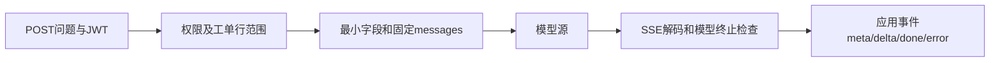

# D45（周三）：Nest转发模型事件流

S2 AI前端 · W7 · 2小时。前置：[D44解析器](D44-SSE协议与增量解析.md)。沿用Nest12.5.0、Prisma7.10.1、zod4.6.7，无新依赖或迁移。

## 今天要做出什么

用 lin 和 wu 依次请求 T-001。记录两次 HTTP 状态、模型源打开次数，以及上游实际收到的 JSON 字段。

在已鉴权的工单详情下增加POST助手接口：先校验工单范围，再读取上游文本delta，转换为自己的事件契约。默认明确模拟模式；真实回环HTTP验证转发，真实中转站未配置。

## 今天的目录结构

- `apps/server/src/app.module.ts`
- `apps/server/src/assistant/assistant.controller.ts`
- `apps/server/src/assistant/assistant.dto.ts`
- `apps/server/src/assistant/assistant.module.ts`
- `apps/server/src/assistant/assistant.service.ts`
- `apps/server/src/assistant/chat.stream.spec.ts`
- `apps/server/src/assistant/chat.stream.ts`
- `apps/server/src/assistant/model.source.ts`
- `apps/server/test/assistant.e2e-spec.ts`
- `apps/server/vitest.config.e2e.ts`
- `packages/shared/src/assistant.ts`
- `packages/shared/src/index.ts`

## 时间安排（120分钟）

回忆10 → 知识点35 → 开发55（协议15、查询15、出口15、测试10）→ 自检20。必做权限范围、事件转换和完整终止；到1小时40分钟砍选做真实供应商联调及扩展usage展示，保留两反证。完整门禁等待另计。

## 零、开头10分钟：闭卷回忆

**1. D44：reader.done与业务done一样吗？**

<details><summary>答案</summary>

前者是字节流EOF，后者是业务终止；缺少业务done只能算中断，解析器不会替业务补成功。

</details>

**2. D42：缺测为什么不能等于健康？**

<details><summary>答案</summary>

缺测表示没有证据。对应今天的流中断，没有数据不等于自然完成，必须有独立状态。

</details>

**3. D38：关闭时为何先结束长连接？**

<details><summary>答案</summary>

等待普通HTTP完成前先让长连接收尾，否则会长时间占用关闭等待；上游取消还需要明确传播，不能只关下游。

</details>

复测[错题本](../学习记录/错题本.md)到期项，未提交过的学习成果不标已掌握。

## 一、知识点与推导（35分钟）

### 1.1 服务端转发承担两条边界



浏览器不能决定model、baseURL、role或材料范围。DTO只接受trim后1—1000字符的问题，未声明字段400。查询使用ticketNo 与 visibleTickets 的交集；跨客户返回404且上游调用次数为0。title仍可能含敏感文本，所以仅用模拟工单练习，字段白名单不等于文本脱敏。

只选ticketNo、category、description 和 logs，不把详情对象的联系人、手机号、事件记录全部发出。权限检查发生在打开上游前，也在200流式头之前；模型生成不会带来任何额外工单权限。

**推导题**：前端已经隐藏二组工单，后端可以直接按ticketNo查吗？

<details><summary>答案</summary>

不能。请求可自行构造，仍须行范围。反证A删掉scope后，二组用户对一组工单实际由404变200。

</details>

### 1.2 上游协议不直接变成页面协议

上游完整SSE data经过JSON与schema校验，读取choices[0].delta.content。role帧可没有正文，usage尾块可choices为空；工具调用、拒绝、未知结束原因都超出本章文本助手能力，拒绝处理。单次增量最多16Ki、累计正文32Ki代码单元，另有D44的帧/字节限制。

只有收到finish_reason为stop或length，且之后收到[DONE]，才发应用done。缺任意一步均协议错误；finish_reason后再出现正文也拒绝。该规则针对本文Chat Completions兼容子集，不保证任意中转站相同。[官方流式响应字段](https://developers.openai.com/api/reference/resources/chat/subresources/completions/streaming-events)。

| 应用事件 | 数据 | 含义 |
|---|---|---|
| meta | mode: mock/model | 说明当前来源，model模式也可能是测试回环源 |
| delta | text | 只追加正文 |
| done | finishReason: stop/length | 自然结束或预算截断 |
| error | 固定code | 保留已有内容，停止成功流程 |

事件名与data.type必须一致，schema拒绝额外下游字段。供应商原始错误不透传，usage不在本章计算或报价。

**推导题**：已经收到stop，TCP正常EOF却没有[DONE]怎么办？

<details><summary>答案</summary>

按本章明确契约算中断，发error，不追加done。保守判定会拒绝省略DONE的提供商，需要适配并实测后才能放宽，不能默默猜结束。

</details>

### 1.3 发头前后是不同错误通道

发头前鉴权/DTO/范围错误用原JSON状态码；打开模型源失败返回JSON503。发出200 text/event-stream后不能再改HTTP状态，只能写应用error后结束响应。RawResponse避免普通成功包裹，@Res直接写流也意味着不能依赖全局对象脱敏器处理文本。

本章设置no-store与X-Accel-Buffering:no；这些头是意图，不能证明每种生产代理都即时刷新。默认模拟源预设四段建议，不执行模型也不执行操作，meta明确mock。测试使用回环上游注入，整套e2e强制模型配置全空，防止回归意外使用真实密钥。

**推导题**：流发到一半抛HTTP503异常，前端能收到新的503吗？

<details><summary>答案</summary>

不能，头已经发出。需要把错误编码为流事件，前端按协议处理。若连接已断则连error也无法送达，下一章处理资源取消。

</details>

### 1.4 本章有意保留的生命周期缺口

传给上游临时15秒AbortSignal，尚未把res.close和应用关闭连起来；慢写入时本章直接失败，未实现等待drain。发送meta之前/之后的资源管理也在D46统一。普通模拟流瞬间完成不能证明取消传播，今天不要把接口当生产网关。

本章只生成建议，不增加重试、并发配额、工具执行或对话持久化。后续必须把超时、关闭和取消绑定到整个请求生命周期。

**推导题**：浏览器点停止，只中断页面fetch，能证明模型不再计费吗？

<details><summary>答案</summary>

不能。服务端需要感知断开并取消上游，即使取消请求传出，供应商实际停止与计费仍须其协议和证据确认。

</details>

## 二、动手开发（55分钟）

### 步骤1：共享契约和上游转换（15分钟）

<details><summary>提示1：方向</summary>

把应用事件定义为判别联合，转换器只产生delta/done。HTTP层负责meta/error。

</details>
<details><summary>提示2：API与位置</summary>

z.discriminatedUnion放shared，server不直接依赖zod。chat.stream调用D44 readSse，参考1.2的终止条件。

</details>
<details><summary>提示3：伪代码</summary>

finish初始null；每帧先识别DONE→要求finish→yield done；否则校验choice→yield文本→记录stop/length；循环EOF直接throw。

</details>

### 步骤2：DTO与工单范围（15分钟）

<details><summary>提示1：方向</summary>

复用现有守卫和visibleTickets，不重新发明权限系统。最小select直接查询，不复用详情JSON。

</details>
<details><summary>提示2：API</summary>

class-transformer trim、class-validator Length；Prisma findFirst({where:{ticketNo,...scope},select:{...}})。

</details>
<details><summary>提示3：骨架</summary>

无可见记录→404；有记录→JSON.stringify最小工单；再buildMessages(context,question)。查询前后不改变工单状态。

</details>

### 步骤3：模型源和POST出口（15分钟）

<details><summary>提示1：方向</summary>

ModelSource全空配置用预设SSE，配置完整则用D43 open(stream:true)，两者都进入同一转换器。

</details>
<details><summary>提示2：API</summary>

@Post、@RequirePermission、@RawResponse、@Res，res.flushHeaders/write/end；注册AssistantModule。错误按headersSent判断通道。

</details>
<details><summary>提示3：骨架</summary>

scope查询→open→200头→meta→for await转换事件→end；catch未发头抛503，已发头写error。D46会替换临时超时与写入策略。

</details>

### 步骤4：接口验证（10分钟）

<details><summary>提示1：方向</summary>

实际Nest+PostgreSQL+Redis，模型端是回环node:http。测试spy只替换ModelSource.open，不绕过守卫、DTO或查询。

</details>
<details><summary>提示2：覆盖项</summary>

401/403/404不调用上游；400问题与额外字段；mock标识；最小字段；完整/中断；发头前503。

</details>
<details><summary>提示3：断言</summary>

用SseParser解下游帧再assistantEventSchema校验，核对事件名与type。中断最后为error，整个数组没有done。

</details>

```powershell
pnpm build
pnpm --filter @ops-ticket/server test src/assistant/chat.stream.spec.ts
pnpm --filter @ops-ticket/server test:e2e test/assistant.e2e-spec.ts
pnpm run ci
```

常见问题：测试全空LLM配置是故意隔离真实供应商，不能删掉。接口测试重建隔离库，不与运行中的应用共享它。

## 三、自检、反证与提交

把 ticketNo 单独用作查询条件，哪条接口断言先失败？

先写下预期，临时去掉对应的检查，保存一次失败结果，再恢复并复跑。在提交记录中写明触发操作、预期、实际结果和用时。

## 四、本章完整源码

**apps/server/src/app.module.ts**

```ts
import { AssistantModule } from './assistant/assistant.module.js';
import { HealthModule } from './health/health.module.js';
import { RedisModule } from './redis/redis.module.js';
import { AuthModule } from './auth/auth.module.js';
import { Module } from '@nestjs/common';
import { AppController } from './app.controller.js';
import { AppService } from './app.service.js';
import { PrismaModule } from './prisma/prisma.module.js';
import { TicketsModule } from './tickets/tickets.module.js';

@Module({
  imports: [AssistantModule, HealthModule, RedisModule, PrismaModule, TicketsModule, AuthModule],
  controllers: [AppController],
  providers: [AppService],
})
export class AppModule {}
```

**apps/server/src/assistant/assistant.controller.ts**

```ts
import { Body, Controller, HttpCode, Param, Post, Req, Res, ServiceUnavailableException } from '@nestjs/common';
import type { Response } from 'express';
import type { AssistantEvent } from '@ops-ticket/shared';
import type { AuthenticatedRequest } from '../auth/auth.types.js';
import { RequirePermission } from '../auth/permissions.decorator.js';
import { AssistantDto } from './assistant.dto.js';
import { AssistantService } from './assistant.service.js';
import { buildMessages, ModelError } from './chat.client.js';
import { parseChatStream } from './chat.stream.js';
import { ModelSource } from './model.source.js';

@Controller('tickets')
export class AssistantController {
  constructor(private readonly assistant: AssistantService, private readonly source: ModelSource) {}
  @Post(':ticketNo/assistant')
  @HttpCode(200)
  @RequirePermission('ticket:report')
  async stream(@Param('ticketNo') ticketNo: string, @Body() dto: AssistantDto,
    @Req() req: AuthenticatedRequest, @Res() res: Response): Promise<void> {
    // 鉴权、DTO和行范围全部通过后，才允许打开上游和发送200流式头。
    const context = await this.assistant.context(ticketNo, req.user!.id);
    const send = (event: AssistantEvent) => {
      if (res.destroyed) throw new ModelError('MODEL_UNAVAILABLE');
      if (!res.write(`event: ${event.type}\ndata: ${JSON.stringify(event)}\n\n`)) throw new ModelError('MODEL_OUTPUT_LIMIT');
    };
    try {
      const source = await this.source.open(buildMessages(context, dto.question), AbortSignal.timeout(15_000));
      res.status(200).set({ 'Content-Type': 'text/event-stream; charset=utf-8', 'Cache-Control': 'no-store', 'X-Accel-Buffering': 'no' });
      res.flushHeaders();
      send({ type: 'meta', mode: source.mode });
      for await (const event of parseChatStream(source.body)) send(event);
    } catch (error) {
      const code = error instanceof ModelError ? error.code : 'MODEL_PROTOCOL_ERROR';
      if (!res.headersSent) throw new ServiceUnavailableException({ code, message: '排查建议暂不可用' });
      if (!res.destroyed) res.write(`event: error\ndata: ${JSON.stringify({ type: 'error', code })}\n\n`);
    } finally { if (res.headersSent && !res.destroyed) res.end(); }
  }
}
```

**apps/server/src/assistant/assistant.dto.ts**

```ts
import { Transform } from 'class-transformer';
import { IsString, Length } from 'class-validator';

export class AssistantDto {
  @Transform(({ value }: { value: unknown }) => typeof value === 'string' ? value.trim() : value)
  @IsString()
  @Length(1, 1000)
  question!: string;
}
```

**apps/server/src/assistant/assistant.module.ts**

```ts
import { Module } from '@nestjs/common';
import { AssistantController } from './assistant.controller.js';
import { AssistantService } from './assistant.service.js';
import { ModelSource } from './model.source.js';

@Module({ controllers: [AssistantController], providers: [AssistantService, ModelSource] })
export class AssistantModule {}
```

**apps/server/src/assistant/assistant.service.ts**

```ts
import { Injectable, NotFoundException } from '@nestjs/common';
import { PrismaService } from '../prisma/prisma.service.js';
import { visibleTickets } from '../tickets/scope.js';
import { redactForLog } from '../common/sensitive.js';

@Injectable()
export class AssistantService {
  constructor(private readonly db: PrismaService) {}

  async context(ticketNo: string, userId: string): Promise<string> {
    const user = await this.db.user.findUniqueOrThrow({ where: { id: userId } });
    const ticket = await this.db.ticket.findFirst({
      where: { AND: [visibleTickets(user), { ticketNo }] },
      select: {
        ticketNo: true, description: true, category: { select: { name: true } },
        materials: { orderBy: { id: 'asc' }, take: 4, select: { logText: true } },
      },
    });
    if (!ticket) throw new NotFoundException('工单不存在');
    return JSON.stringify({
      ticketNo, category: ticket.category.name, description: redactForLog(ticket.description).slice(0, 1600),
      logs: ticket.materials.map(item => redactForLog(item.logText).slice(0, 800)),
    });
  }
}
```

**apps/server/src/assistant/chat.stream.spec.ts**

```ts
import { parseChatStream } from './chat.stream.js';
const wire = (content: string, reason: string | null = null) => `data: ${JSON.stringify({ choices: [{ index: 0, delta: { content }, finish_reason: reason }] })}\n\n`;
async function collect(text: string) { const output = []; for await (const event of parseChatStream(new Response(text).body!)) output.push(event); return output; }
describe('模型事件转换（D45）', () => {
  it('正文增量不回退，stop和DONE后才完成', async () => {
    expect(await collect(wire('中文') + wire('', 'stop') + 'data: [DONE]\n\n')).toEqual([{ type: 'delta', text: '中文' }, { type: 'done', finishReason: 'stop' }]);
  });
  it('length与空choices的usage尾块均保留语义', async () => {
    expect(await collect(wire('部分', 'length') + 'data: {"choices":[],"usage":{}}\n\ndata: [DONE]\n\n')).toEqual([{ type: 'delta', text: '部分' }, { type: 'done', finishReason: 'length' }]);
  });
  it('缺少DONE不能把EOF当完成', async () => { await expect(collect(wire('partial', 'stop'))).rejects.toThrow('MODEL_PROTOCOL_ERROR'); });
  it('没有finish_reason先DONE应拒绝', async () => { await expect(collect(wire('partial') + 'data: [DONE]\n\n')).rejects.toThrow('MODEL_PROTOCOL_ERROR'); });
  it('未知结束原因拒绝', async () => { await expect(collect(wire('', 'tool_calls') + 'data: [DONE]\n\n')).rejects.toThrow('MODEL_PROTOCOL_ERROR'); });
  it('拒绝非法JSON和非零choice', async () => {
    await expect(collect('data: broken\n\n')).rejects.toThrow('MODEL_PROTOCOL_ERROR');
    await expect(collect('data: {"choices":[{"index":1,"delta":{},"finish_reason":null}]}\n\n')).rejects.toThrow('MODEL_PROTOCOL_ERROR');
  });
  it('结束原因之后不接受更多正文', async () => { await expect(collect(wire('', 'stop') + wire('late'))).rejects.toThrow('MODEL_PROTOCOL_ERROR'); });
  it('单增量超限拒绝', async () => { await expect(collect(wire('x'.repeat(16_385)))).rejects.toThrow('MODEL_OUTPUT_LIMIT'); });
});
```

**apps/server/src/assistant/chat.stream.ts**

```ts
import { chatChunkSchema, readSse } from '@ops-ticket/shared';
import { ModelError } from './chat.client.js';

export type ModelEvent = { type: 'delta'; text: string } | { type: 'done'; finishReason: 'stop' | 'length' };
export async function* parseChatStream(body: ReadableStream<Uint8Array>): AsyncGenerator<ModelEvent> {
  let finish: 'stop' | 'length' | null = null;
  let chars = 0;
  for await (const frame of readSse(body)) {
    if (frame.event !== 'message') throw new ModelError('MODEL_PROTOCOL_ERROR');
    if (frame.data === '[DONE]') {
      if (!finish) throw new ModelError('MODEL_PROTOCOL_ERROR');
      yield { type: 'done', finishReason: finish }; return;
    }
    let input: unknown;
    try { input = JSON.parse(frame.data) as unknown; } catch { throw new ModelError('MODEL_PROTOCOL_ERROR'); }
    const parsed = chatChunkSchema.safeParse(input);
    if (!parsed.success) throw new ModelError('MODEL_PROTOCOL_ERROR');
    const choice = parsed.data.choices[0];
    if (!choice) continue; // 允许usage尾块没有choice；不推断费用。
    if (finish || choice.delta.refusal || choice.delta.tool_calls !== undefined) throw new ModelError('MODEL_PROTOCOL_ERROR');
    const text = choice.delta.content;
    if (text) {
      chars += text.length;
      if (chars > 32_768 || text.length > 16_384) throw new ModelError('MODEL_OUTPUT_LIMIT');
      yield { type: 'delta', text };
    }
    if (choice.finish_reason !== null) {
      if (choice.finish_reason !== 'stop' && choice.finish_reason !== 'length') throw new ModelError('MODEL_PROTOCOL_ERROR');
      finish = choice.finish_reason;
    }
  }
  // HTTP EOF不是模型成功结束，缺少DONE时保留已经发出的部分结果并报错。
  throw new ModelError('MODEL_PROTOCOL_ERROR');
}
```

**apps/server/src/assistant/model.source.ts**

```ts
import { Injectable } from '@nestjs/common';
import { ChatClient, ModelError, type ChatMessage } from './chat.client.js';
import { readModelConfig } from './model.config.js';

@Injectable()
export class ModelSource {
  async open(messages: ChatMessage[], signal: AbortSignal): Promise<{ body: ReadableStream<Uint8Array>; mode: 'mock' | 'model' }> {
    const config = readModelConfig();
    if (!config) {
      // W7默认可演示夹具；这是预设文本，不冒充模型推理，也不执行任何操作。
      const pieces = ['这是模拟排查建议。', '\n1. 核对报障时间和日志中的超时记录。', '\n2. 对比近期变更与监控曲线。', '\n3. 记录证据后由人工决定下一步。'];
      const events = pieces.map((content) => ({ choices: [{ index: 0, delta: { content }, finish_reason: null }] }));
      const wire = events.map((event) => `data: ${JSON.stringify(event)}\n\n`).join('')
        + 'data: {"choices":[{"index":0,"delta":{},"finish_reason":"stop"}]}\n\ndata: [DONE]\n\n';
      return { body: new Response(wire).body!, mode: 'mock' };
    }
    const response = await new ChatClient(config).open(messages, true, signal);
    if (!response.headers.get('content-type')?.startsWith('text/event-stream') || !response.body) {
      await response.body?.cancel(); throw new ModelError('MODEL_PROTOCOL_ERROR');
    }
    return { body: response.body, mode: 'model' };
  }
}
```

**apps/server/test/assistant.e2e-spec.ts**

```ts
import type { INestApplication } from '@nestjs/common';
import { Test } from '@nestjs/testing';
import { createServer, type Server } from 'node:http';
import type { AddressInfo } from 'node:net';
import { appendFileSync } from 'node:fs';
import request from 'supertest';
import { assistantEventSchema, SseParser } from '@ops-ticket/shared';
import { AppModule } from '../src/app.module.js';
import { configureApp } from '../src/app.setup.js';
import { ModelSource } from '../src/assistant/model.source.js';
import { ChatClient } from '../src/assistant/chat.client.js';
import { bearer } from './login-fixtures.js';
import { PrismaService } from '../src/prisma/prisma.service.js';
const report = (data: object) => { if (process.env.D45_EVIDENCE_FILE) appendFileSync(process.env.D45_EVIDENCE_FILE, JSON.stringify(data) + '\n'); };
const wire = (content: string, reason: string | null = null) => `data: ${JSON.stringify({ choices: [{ index: 0, delta: { content }, finish_reason: reason }] })}\n\n`;
describe('工单AI助手出口（D45）', () => {
  let app: INestApplication; let auth: (username: string) => string;
  let upstream: Server; let endpoint: string; let answer = ''; let calls = 0; let body: Record<string, unknown> = {};
  beforeAll(async () => {
    upstream = createServer((req, res) => {
      calls++; let text = ''; req.on('data', (chunk: Buffer) => { text += chunk.toString(); });
      req.on('end', () => { body = JSON.parse(text) as Record<string, unknown>; res.setHeader('Content-Type', 'text/event-stream'); res.end(answer); });
    });
    await new Promise<void>((resolve) => upstream.listen(0, '127.0.0.1', resolve));
    endpoint = `http://127.0.0.1:${(upstream.address() as AddressInfo).port}/v1/chat/completions`;
    const module = await Test.createTestingModule({ imports: [AppModule] }).compile();
    app = module.createNestApplication(); configureApp(app); await app.init(); const tokens = new Map<string,string>();
    for (const name of ['lin','wu']) tokens.set(name,await bearer(app,name));
    auth = name => tokens.get(name)!;
  });
  afterEach(() => vi.restoreAllMocks());
  afterAll(async () => { upstream.closeAllConnections(); await new Promise<void>((resolve) => upstream.close(() => resolve())); await app.close(); });
  const post = (user = 'lin') => request(app.getHttpServer()).post('/api/tickets/T-001/assistant').set('authorization', auth(user));
  function local() {
    return vi.spyOn(app.get(ModelSource), 'open').mockImplementation(async (messages, signal) => {
      const response = await new ChatClient({ endpoint, apiKey: 'fake-local-key', model: 'mock-model' }).open(messages, true, signal);
      return { body: response.body!, mode: 'model' };
    });
  }
  const events = (text: string) => new SseParser().push(text).map((frame) => { const event = assistantEventSchema.parse(JSON.parse(frame.data)); expect(frame.event).toBe(event.type); return event; });
  it('未登录返回401且不调用上游', async () => {
    const spy = local();
    await request(app.getHttpServer()).post('/api/tickets/T-001/assistant').send({ question: '模拟问题' }).expect(401);
    expect(spy).not.toHaveBeenCalled();
  });
  it('跨客户不可见工单404且不调用模型', async () => {
    const spy = local(); await post('wu').send({ question: '模拟问题' }).expect(404); expect(spy).not.toHaveBeenCalled();
    report({ case: 'scope-before-model', status: 404, upstreamCalls: spy.mock.calls.length });
  });
  it('拒绝空白、过长问题及客户端模型配置', async () => {
    const spy = local();
    for (const input of [{ question: '   ' }, { question: 'x'.repeat(1001) }, { question: '模拟', model: 'override' }, { question: '模拟', role: 'system' }]) await post().send(input).expect(400);
    expect(spy).not.toHaveBeenCalled();
  });
  it('默认演示明确标mock，正文和done遵守共享契约', async () => {
    const db = app.get(PrismaService);
    const before = await db.ticket.findUniqueOrThrow({where:{ticketNo:'T-001'}});
    const res = await post().send({ question: '模拟问题' }).expect(200);
    expect(await db.ticket.findUniqueOrThrow({where:{id:before.id}})).toMatchObject({version:before.version,status:before.status});
    expect(res.headers['content-type']).toContain('text/event-stream'); expect(res.headers['cache-control']).toBe('no-store');
    const output = events(res.text); expect(output[0]).toEqual({ type: 'meta', mode: 'mock' }); expect(output.at(-1)).toEqual({ type: 'done', finishReason: 'stop' });
    report({ case: 'mock-stream', eventTypes: output.map((event) => event.type), mode: 'mock' });
  });
  it('真实回环上游只收到最小工单材料，正文逐事件转发', async () => {
    local(); const before = calls; answer = wire('建议一') + wire('建议二', 'stop') + 'data: [DONE]\n\n';
    const res = await post().send({ question: '模拟问题' }).expect(200);
    const messages = body.messages as { role: string; content: string }[];
    const context = JSON.parse(JSON.parse(messages[1].content).ticket) as Record<string, unknown>;
    expect(Object.keys(context).sort()).toEqual(['category', 'description', 'logs', 'ticketNo']); expect(context.logs).toContain('client timeout after 5s'); expect(body.stream).toBe(true); expect(calls - before).toBe(1);
    expect(events(res.text)).toEqual([{ type: 'meta', mode: 'model' }, { type: 'delta', text: '建议一' }, { type: 'delta', text: '建议二' }, { type: 'done', finishReason: 'stop' }]);
    report({ case: 'loopback-stream', contextFields: Object.keys(context).sort(), upstreamCalls: calls - before, eventTypes: events(res.text).map((event) => event.type) });
  });
  it('上游EOF中断后只发error，不能伪造done', async () => {
    local(); answer = wire('部分建议', 'stop');
    const output = events((await post().send({ question: '模拟' }).expect(200)).text);
    expect(output.at(-1)).toEqual({ type: 'error', code: 'MODEL_PROTOCOL_ERROR' }); expect(output.some((event) => event.type === 'done')).toBe(false);
    report({ case: 'interrupted-stream', eventTypes: output.map((event) => event.type), last: output.at(-1) });
  });
  it('上游在发头之前失败则JSON503不泄漏文本', async () => {
    vi.spyOn(app.get(ModelSource), 'open').mockRejectedValue(new Error('fake-private-body'));
    const res = await post().send({ question: '模拟' }).expect(503); expect(res.text).not.toContain('fake-private-body'); expect(res.headers['content-type']).toContain('application/json');
  });
});
```

**apps/server/vitest.config.e2e.ts**

```ts
import 'dotenv/config';
import { defineConfig } from 'vitest/config';
import { preflightTestResources } from './test/test-resources.js';

const resources = preflightTestResources(process.env);

export default defineConfig({
  resolve: { tsconfigPaths: true },
  test: {
    globals: true,
    root: './',
    include: ['**/*.e2e-spec.ts'],
    // 测试前重建测试库（只执行一次）
    globalSetup: ['./test/global-setup.ts'],
    // 所有测试进程都连测试库，不碰开发库
    env: {
      // 全套回归永远不访问付费模型，真实兼容验证另行运行。
      LLM_BASE_URL: '', LLM_API_KEY: '', LLM_MODEL: '',
      DATABASE_URL: resources.database,
      // Redis 也和开发环境分开：用 1 号库（D22）
      REDIS_URL: resources.cacheRedis,
      // 队列用的 Redis 也用 1 号库（D29）
      QUEUE_REDIS_URL: resources.queueRedis,
      // D32：空的测试 Redis 里不注册调度，用例自己调用或使用独立队列
      SLA_SCAN_INTERVAL_MS: '0',
      // 用例按专用输入运行 Outbox。
      OUTBOX_RELAY_INTERVAL_MS: '0',
    },
    // 多个测试文件共用一个库，按顺序执行，避免互相干扰
    fileParallelism: false,
  },
});
```

**packages/shared/src/assistant.ts**

```ts
import { z } from 'zod';

export const assistantEventSchema = z.discriminatedUnion('type', [
  z.object({ type: z.literal('meta'), mode: z.enum(['mock', 'model']) }).strict(),
  z.object({ type: z.literal('delta'), text: z.string().max(16_384) }).strict(),
  z.object({ type: z.literal('done'), finishReason: z.enum(['stop', 'length']) }).strict(),
  z.object({ type: z.literal('error'), code: z.enum(['MODEL_UNAVAILABLE', 'MODEL_PROTOCOL_ERROR', 'MODEL_OUTPUT_LIMIT', 'MODEL_TIMEOUT', 'MODEL_CANCELLED']) }).strict(),
]);
export type AssistantEvent = z.infer<typeof assistantEventSchema>;

// 兼容协议只验证本文消费的字段；供应商附加的id/usage允许保留在上游。
export const chatChunkSchema = z.object({
  choices: z.array(z.object({
    index: z.literal(0),
    delta: z.object({ content: z.string().nullable().optional(), role: z.string().optional(), refusal: z.string().nullable().optional(), tool_calls: z.unknown().optional() }),
    finish_reason: z.string().nullable(),
  })).max(1),
});
```

**packages/shared/src/index.ts**

```ts
// 前后端共用的接口契约：取值常量、zod schema 和由它推导出的类型
export * from './api.js';
export * from './ticket.js';
export * from './permissions.js';
export * from './sse.js';
export * from './assistant.js';
```

## 五、核心面试题

1. 转发层为什么不直接pipe？要点：权限、协议转换、业务结束条件、错误分类。
2. 为什么stop后还等待DONE？要点：本文兼容子集明确约定，EOF不能证明完整。
3. 发头后怎样报错？要点：SSE error、保留部分结果、已断开无法送达。

完整答案与题库见[D45面试题](D45-面试题.md)。

## 六、个人建议

今天把W3的范围控制和W7的模型流连接起来。面试可讲“二组用户构造一组编号，必须在任何外部调用前404”的反证，这比只展示打字效果更能证明工程判断。不要把模拟接口描述为已完成生产模型网关。

## 七、拓展知识点

| 主题 | 价值 | 程度/时间 |
|---|---|---|
| 模型网关错误分类 | 429与预算重试 | W9，不在本章自动重试 |
| 审核与数据治理 | 最小字段仍可能敏感 | 真实数据接入前单独设计 |
| 背压与取消 | 防止断连仍消耗资源 | D46继续 |
| 流式前端状态 | 区分部分/截断/完成 | D47与D48 |

## 本文验证范围

本机复跑助手协议与流生命周期 42 项，含两套客户端与服务端共 25 项 HTTP 回归。Vue 工程 117 项测试通过。 [后端接口记录](../.cache/验证/新版验收/D56-http.log) · [助手单元记录](../.cache/验证/新版验收/D56-assistant-unit.log) · [前端记录](../.cache/验证/新版验收/D56-web.log)。

助手流使用本地受控上游。端到端浏览器交互、真实模型诊断质量和长时连接需另验。
