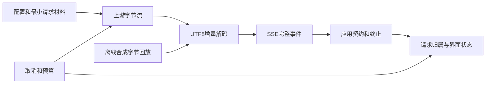

# D49（周日）：第七周复盘

S2 AI 前端 · W7 · 5 小时。前置：[D48 工单AI排查助手集成](D48-工单AI排查助手集成.md)与自己的W7代码。沿用Vue 3.5.44、Vite 8.3.8、Vitest 4.1.12；无新依赖、数据库迁移或业务接口。

## 今天要做出什么

闭卷画出浏览器、Nest、模型源三者的事件时序；用真实回放器分别输入 done、EOF 和用户取消。

闭卷串起模型请求、字节解码、SSE事件、应用终止、后端取消和前端归属。写一个离线字节回放器：同一条合成响应换任何双块切点，结果必须一致；缺终止、损坏UTF-8与错误事件不能冒充完成。最后完成两反证、8题口述和个人W7小结。

回放器只读测试构造的字节数组，不录制真实工单、不保存供应商内容、不发网络请求。它是调试协议的练习，不是断线续传或会话存储。

## 今天的目录结构

- `apps/web/src/api/assistant.ts`
- `apps/web/src/assistant/replay.spec.ts`
- `apps/web/src/assistant/replay.ts`

## 时间安排（300 分钟）

| 环节 | 分钟 | 产出 |
|---|---:|---|
| 闭卷回忆 | 40 | 12题与错题复测 |
| 知识地图 | 25 | 分清字节/事件/状态/资源 |
| 变式练习 | 105 | 共用消费入口、回放与测试 |
| 自检与两反证 | 40 | 失败、恢复、门禁 |
| 模拟面试 | 60 | 8题，每题含追问 |
| 小结与提交 | 30 | W7证据边界、W8准备 |

到4小时30分钟，先砍选做的随机分块与界面回放面板，保留确定性全切点、错误终态和两反证。完整回归等待另计；没做完写明阻碍与提示等级。

## 零、闭卷回忆（40 分钟）

先答一分钟再展开。0分答不上，1分只会名词，2分能说明失败路径。前三题按1/3/7天间隔。

**1. D48：切工单和卸载分别在哪清理？**

<details><summary>答案</summary>

useTicketAssistant监听工单getter同步reset，作用域结束dispose；D47身份watch同步清理；旧回调、catch、finally还要检查序号和token。

</details>

**2. D46：空闲超时与总超时为什么都需要？**

<details><summary>答案</summary>

空闲限制没有应用事件进展的等待，总时限限制持续小块输出的无限占用。touch只更新idle，预算从工单查询之后开始；数据库查询时间还不在预算内。

</details>

**3. D42：缺失证据能记成健康吗？这周对应什么？**

<details><summary>答案</summary>

不能。D42缺测不是零错误；本周EOF也不是done，没真实模型配置不是真实模型已验证。缺失终止要报告中断并保留部分结果。

</details>

**4. D43：三项模型配置只填一项时怎么处理？**

<details><summary>答案</summary>

全部空才可用明确模拟；部分配置报错，不能无声回退掩盖配置错误。密钥只在后端，URL只允许HTTPS或回环HTTP且拒绝认证/query/hash。

</details>

**5. D43：max_completion_tokens等于文本字符数吗？**

<details><summary>答案</summary>

不等于。token由模型分词与计费协议决定，JS length是UTF-16代码单元，网络预算按字节；三者不可互换。具体参数支持需要中转站实测。

</details>

**6. D44：一个read结果就是一条SSE吗？**

<details><summary>答案</summary>

可能含半个UTF-8字符、半行或多事件。持久TextDecoder以stream:true解码，再累积行直到空行分派；多data用换行连接。

</details>

**7. D44：遇到EOF要不要补空行？**

<details><summary>答案</summary>

不补，未完整结束的帧丢弃。业务消费方仍需收到合法done/error；完整传输和应用成功是两层。

</details>

**8. D45：为什么不把上游JSON直接转发给前端？**

<details><summary>答案</summary>

上游choices、finish_reason与客户端协议耦合且可能包含无关字段。本项目映射为meta/delta/done/error；只支持单文本choice，拒绝工具调用与未知结束原因。

</details>

**9. D45：工单白名单只有四字段，是否已经脱敏？**

<details><summary>答案</summary>

不是。title本身可能含敏感信息，用户问题也可能含真实资料。白名单减少字段，无法证明内容安全；练习只用模拟数据。

</details>

**10. D46：为什么用res.close检查异常断开？**

<details><summary>答案</summary>

POST请求体可早已完整读取，req.close不代表响应消费者离开。res.close配writableFinished判断未正常完成，再取消上游和等待drain；真实供应商是否停止计费仍未证明。

</details>

**11. D47：只abort旧请求能避免所有串内容吗？**

<details><summary>答案</summary>

不能，回调可能已排队或transport不合作。递增序号、捕获身份并保护回调/catch/finally；旧401还要确认当前token相同才注销。

</details>

**12. D48：浏览器看到“模拟输出”证明了什么？**

<details><summary>答案</summary>

证明当前meta.mode与展示一致。配合实际服务可验证本机流式链路，但不证明模型推理质量、参数兼容、费用或生产代理。异常夹具仅证明前端处理。

</details>

复测[错题本](../学习记录/错题本.md)到期项；本周尚无用户提交，作者不写“你已掌握”。本日薄弱点安排D50/D52/D56复测。

## 一、知识地图与回放规则（25 分钟）



| 层 | 判断什么 | 本周不能证明什么 |
|---|---|---|
| 模型HTTP | 配置、状态、媒体类型与请求字段 | 外部供应商兼容与账单 |
| 字节/SSE | UTF-8、CRLF、多data、大小限制 | 业务完成或答案正确 |
| 应用协议 | meta首帧、event/type、done/error | 内容无幻觉、可直接执行 |
| 生命周期 | 本机取消、预算、清理与drain | 任意非合作上游停止、关闭硬截止 |
| Vue状态 | 旧结果隔离、停止保留、路由清理 | 长会话性能、持久恢复 |

### 1.1 变式验收契约

输入`readonly Uint8Array[]`，数组元素代表传输分块；共用consumeAssistantBody，不复制另一套SSE解析规则。报告`mode/text/state/code/eventCount`，只计已经通过校验并交给回调的事件。

- done.stop→completed，done.length→truncated；合法error保留错误码，按有无正文分interrupted/error。
- 缺终止或协议失败保留已接受正文；有正文为interrupted，无正文为error。
- signal已取消则cancelled，不回放任何事件。
- 首个合法终止后忽略尾部，本章不审计已经结束之后的传输内容。
- 同一合法字节序列的所有双块切点和逐字节输入都必须得到相同报告。

**推导题**：为什么不先把所有块拼成一个字符串再JSON.parse？

<details><summary>答案</summary>

那会绕过增量解码和半帧边界，无法验证真实网络下最容易出错的部分。SSE也不是单个JSON文档；本练习必须走相同的readSse和应用契约。

</details>

### 1.2 “结果一致”不是拿实现自身当唯一答案

先断言完整块结果为预期的中文、completed和3个事件，再把各切点与该结果比较。若只比较两个同样错误的输出，会得到假信心。另有独立断言覆盖缺meta、事件名不符、UTF-8损坏、半终止帧和大小超限。

**推导题**：全切点通过是否证明所有网络情况都覆盖？

<details><summary>答案</summary>

只覆盖这条合成字节序列的所有双块分法，再加一种逐字节分法。没有穷举所有多块组合、延时、并发和真实代理，不能写成任意网络可靠性证明。

</details>

### 1.3 回放不能伪造一次成功

catch将失败转成可查看报告，但必须保留失败语义。不要为了调试工具“总返回一个结果”而默认completed。共享协议错误码来自受控类，未知异常只报REPLAY_FAILED，避免输出原始异常文本。

**推导题**：eventCount为2且text不空，为何仍可失败？

<details><summary>答案</summary>

可能只收到meta和delta，没有终止；数量与文字都不能代替done。反证A正是把catch错误标为completed，测试应明确失败。

</details>

## 二、变式练习（105 分钟）

### 步骤1：抽出在线、离线共用入口（25分钟）

<details><summary>提示1：方向</summary>

只分离HTTP外壳和流消费，不改变D47权限错误、请求字段和终止规则。

</details>
<details><summary>提示2：API与位置</summary>

api/assistant.ts导出consumeAssistantBody(body,signal,receive)；streamAssistant检查HTTP和媒体类型后调用它。

</details>
<details><summary>提示3：骨架</summary>

fetch→HTTP错误/401处理→媒体类型→consume；原readSse循环整体迁入新函数，仍在done/error后return，EOF仍抛错。

</details>

### 步骤2：写离线报告（35分钟）

<details><summary>提示1：方向</summary>

用ReadableStream.pull逐块提供数组元素，让真实消费逻辑决定什么时候读取和取消。

</details>
<details><summary>提示2：状态字段</summary>

meta设置mode；delta追加text；done设置completed/truncated；error设置code；catch根据signal及部分正文设置cancelled/interrupted/error。

</details>
<details><summary>提示3：骨架</summary>

初始化空报告→await consume(callback)→catch转换固定错误→返回报告。不要调用streamAssistant，否则会真的发POST。

</details>

### 步骤3：构造有解释力的用例（45分钟）

<details><summary>提示1：方向</summary>

选择包含BOM、注释、CRLF、中文和emoji的正常流；先验证期望，再遍历所有二分切点。

</details>
<details><summary>提示2：用例矩阵</summary>

完整/length/error/无终止/半终止/无meta/重复meta/event不一致/非法UTF-8/总文本超限/提前取消；检查部分文字和固定错误码。

</details>
<details><summary>提示3：骨架</summary>

TextEncoder得到bytes；for cut=0..length，slice(0,cut)与slice(cut)回放；另Array.from(bytes,Uint8Array.of)逐字节；预期输出不能由相同算法生成。

</details>

```powershell
pnpm --filter @ops-ticket/web test src/assistant/replay.spec.ts src/api/assistant.spec.ts
pnpm run ci
```

常见问题：shared从dist导入，修改它后先build；本章不改shared。离线结果没有时间戳，不可拿数组块数估计真实token数或首字耗时。

## 三、自检、反证与提交

HTTP 200 加一段完整文字能算解决问题吗？

先写下预期，临时去掉对应的检查，保存一次失败结果，再恢复并复跑。在提交记录中写明触发操作、预期、实际结果和用时。

## 四、本章完整源码

**apps/web/src/api/assistant.ts**

```ts
import { assistantEventSchema, readSse, type AssistantEvent } from '@ops-ticket/shared'
import { handleUnauthorized, session } from './session'

export class AssistantError extends Error {}
// 单次POST不自动重试；只有应用终止事件才能完成。
export async function streamAssistant(ticketNo: string, question: string, token: string,
  signal: AbortSignal, receive: (event: AssistantEvent) => void): Promise<void> {
  const response = await fetch(`/api/tickets/${encodeURIComponent(ticketNo)}/assistant`, {
    method: 'POST', headers: { Authorization: `Bearer ${token}`, 'Content-Type': 'application/json', Accept: 'text/event-stream' },
    body: JSON.stringify({ question }), signal,
  })
  if (!response.ok) {
    await response.body?.cancel()
    if (response.status === 401 && token === session.value?.accessToken) handleUnauthorized()
    throw new AssistantError(response.status === 401 ? 'UNAUTHENTICATED' : response.status === 404 ? 'NOT_FOUND' : response.status === 403 ? 'FORBIDDEN' : 'HTTP_ERROR')
  }
  if (!response.headers.get('content-type')?.startsWith('text/event-stream') || !response.body) {
    await response.body?.cancel(); throw new AssistantError('CONTRACT_MISMATCH')
  }
  await consumeAssistantBody(response.body, signal, receive)
}

// 在线请求与离线回放共用同一套应用协议校验。
export async function consumeAssistantBody(body: ReadableStream<Uint8Array>, signal: AbortSignal,
  receive: (event: AssistantEvent) => void): Promise<void> {
  let meta = false; let chars = 0
  for await (const frame of readSse(body, { signal })) {
    let value: unknown
    try { value = JSON.parse(frame.data) as unknown } catch { throw new AssistantError('CONTRACT_MISMATCH') }
    const parsed = assistantEventSchema.safeParse(value)
    if (!parsed.success || frame.event !== parsed.data.type) throw new AssistantError('CONTRACT_MISMATCH')
    const event = parsed.data
    if (event.type === 'meta') {
      if (meta) throw new AssistantError('CONTRACT_MISMATCH')
      meta = true
    } else if (!meta) throw new AssistantError('CONTRACT_MISMATCH')
    if (event.type === 'delta') {
      chars += event.text.length
      if (chars > 32_768) throw new AssistantError('OUTPUT_LIMIT')
    }
    receive(event)
    if (event.type === 'done' || event.type === 'error') return
  }
  throw new AssistantError('STREAM_INTERRUPTED')
}
```

**apps/web/src/assistant/replay.spec.ts**

```ts
import { describe, expect, it, vi } from 'vitest'
import { appendFileSync } from 'node:fs'
import { replayAssistant } from './replay'
const frame = (type: string, data: object) => `event: ${type}\r\ndata: ${JSON.stringify({ type, ...data })}\r\n\r\n`
const meta = frame('meta', { mode: 'mock' }); const delta = frame('delta', { text: '排查中文🙂' }); const done = frame('done', { finishReason: 'stop' })
const bytes = (text: string) => new TextEncoder().encode(text)
const replay = (text: string) => replayAssistant([bytes(text)])
const report = (value: object) => { if (process.env.D49_EVIDENCE_FILE) appendFileSync(process.env.D49_EVIDENCE_FILE, JSON.stringify(value) + '\n') }
describe('离线字节回放（D49）', () => {
  it('所有双块切点及逐字节回放结果一致', async () => {
    const wire = bytes('\uFEFF: heartbeat\r\n\r\n' + meta + delta + done)
    const expected = await replayAssistant([wire]); expect(expected).toMatchObject({ state: 'completed', text: '排查中文🙂', eventCount: 3 })
    for (let cut = 0; cut <= wire.length; cut++) expect(await replayAssistant([wire.slice(0, cut), wire.slice(cut)])).toEqual(expected)
    expect(await replayAssistant(Array.from(wire, (value) => Uint8Array.of(value)))).toEqual(expected)
    report({ case: 'replay-boundaries', bytes: wire.length, splitCases: wire.length + 1, oneByteChunks: true, result: expected })
  })
  it('缺终止保留部分且报告interrupted', async () => {
    const result = await replay(meta + delta); expect(result).toMatchObject({ state: 'interrupted', text: '排查中文🙂', code: 'STREAM_INTERRUPTED' })
    report({ case: 'replay-interrupted', result })
  })
  it('length保持truncated', async () => { expect(await replay(meta + delta + frame('done', { finishReason: 'length' }))).toMatchObject({ state: 'truncated', code: null }) })
  it('服务error保留部分及固定错误码', async () => { expect(await replay(meta + delta + frame('error', { code: 'MODEL_TIMEOUT' }))).toMatchObject({ state: 'interrupted', text: '排查中文🙂', code: 'MODEL_TIMEOUT' }) })
  it('事件名和type不一致拒绝', async () => {
    expect(await replay(meta + 'event: done\ndata: {"type":"delta","text":"伪装"}\n\n' + done)).toMatchObject({ state: 'error', code: 'CONTRACT_MISMATCH', text: '' })
  })
  it('缺meta或重复meta拒绝', async () => {
    for (const wire of [delta + done, meta + meta + done]) expect(await replay(wire)).toMatchObject({ state: 'error', code: 'CONTRACT_MISMATCH' })
  })
  it('半个终止帧不自动补全', async () => { expect(await replay(meta + delta + done.slice(0, -2))).toMatchObject({ state: 'interrupted', code: 'STREAM_INTERRUPTED' }) })
  it('损坏UTF8不替换成乱码', async () => { expect(await replayAssistant([bytes(meta), Uint8Array.of(0xff)])).toMatchObject({ state: 'error', code: 'SSE_INVALID_UTF8' }) })
  it('累计正文超过预算时保留已接受内容', async () => {
    const piece = frame('delta', { text: 'x'.repeat(16_384) }); const result = await replay(meta + piece + piece + frame('delta', { text: 'x' }) + done)
    expect(result).toMatchObject({ state: 'interrupted', code: 'OUTPUT_LIMIT' }); expect(result.text).toHaveLength(32_768)
  })
  it('首个终止之后不再接收后续事件', async () => { expect(await replay(meta + delta + done + frame('error', { code: 'MODEL_TIMEOUT' }))).toMatchObject({ state: 'completed', eventCount: 3, code: null }) })
  it('已取消时无输出且不访问fetch', async () => {
    const fetcher = vi.spyOn(globalThis, 'fetch'); const abort = new AbortController(); abort.abort()
    try { expect(await replayAssistant([bytes(meta + delta + done)], abort.signal)).toMatchObject({ state: 'cancelled', text: '', eventCount: 0 }); expect(fetcher).not.toHaveBeenCalled() } finally { fetcher.mockRestore() }
  })
})
```

**apps/web/src/assistant/replay.ts**

```ts
import { SseError } from '@ops-ticket/shared'
import { AssistantError, consumeAssistantBody } from '../api/assistant'

export interface ReplayResult {
  mode: 'mock' | 'model' | null
  text: string
  state: 'completed' | 'truncated' | 'interrupted' | 'error' | 'cancelled'
  code: string | null
  eventCount: number
}

// 只回放合成字节块，不访问网络、不保存真实用户或模型内容。
export async function replayAssistant(chunks: readonly Uint8Array[], signal = new AbortController().signal): Promise<ReplayResult> {
  let index = 0
  const body = new ReadableStream<Uint8Array>({
    pull(controller) { if (index < chunks.length) controller.enqueue(chunks[index++]!); else controller.close() },
  })
  const result: ReplayResult = { mode: null, text: '', state: 'error', code: null, eventCount: 0 }
  try {
    await consumeAssistantBody(body, signal, (event) => {
      result.eventCount++
      if (event.type === 'meta') result.mode = event.mode
      if (event.type === 'delta') result.text += event.text
      if (event.type === 'done') result.state = event.finishReason === 'length' ? 'truncated' : 'completed'
      if (event.type === 'error') { result.state = result.text ? 'interrupted' : 'error'; result.code = event.code }
    })
  } catch (cause) {
    result.state = signal.aborted ? 'cancelled' : result.text ? 'interrupted' : 'error'
    result.code = signal.aborted ? 'CANCELLED' : cause instanceof AssistantError || cause instanceof SseError ? cause.message : 'REPLAY_FAILED'
  }
  return result
}
```

## 五、核心面试题与60分钟模拟

1. 从用户按生成到done，画出所有协议边界。要点：权限、字段、UTF-8、SSE、应用schema、终止与状态。
2. 中断后怎样避免串内容和资源泄漏？要点：端到端signal、序号、身份、路由与finally。
3. 如何证明流式实现正确，证据有什么限制？要点：全切点、真实HTTP、故障夹具、两反证、外部模型边界。

完整8题和追问见[D49面试题](D49-面试题.md)。每题先答2分钟、追问2分钟、对照2分钟，最后12分钟重答最弱两题。

## 六、个人建议与30分钟小结

你熟悉Vue，W7的价值是把界面状态与服务端资源、字节协议连接起来。小结写三条：哪次失败推翻了直觉；哪一层仍缺证据；下一次如何最小化复现。简历可以写“实现可取消的工单建议流与异常状态，使用本机模拟验证”，不能写真实模型上线、费用下降或生产吞吐提升。

W8进入会话界面工程前，先用本周协议稳定驱动UI。Markdown、自动滚动和工具卡片都不能绕过已有的终止、身份与工单边界。若尚不能独立解释EOF和done，先复测D44/D47，不把新组件数量当进步。

## 七、拓展知识点

| 方向 | 为什么学 | 学到什么程度与时机 |
|---|---|---|
| 属性测试与随机分块 | 扩展合成输入空间 | 先有独立预期、固定种子与可复现失败，再增加随机化 |
| 版本化事件 | 多种卡片和兼容演进 | W8显式版本/事件身份，不直接复用供应商原文 |
| 录制脱敏 | 复现真实故障 | 需最小化、权限与保留规则，本周不录真实内容 |
| 供应商验证 | 确认参数/finish_reason/费用 | 配置齐后只用模拟问题做小量验证，不能靠离线证明 |

## 本文验证范围

本机复跑助手协议与流生命周期 42 项，10 个 HTTP 测试文件共 25 项通过。Vue 工程 117 项测试通过。 [后端接口记录](../.cache/验证/新版验收/D56-http.log) · [助手单元记录](../.cache/验证/新版验收/D56-assistant-unit.log) · [前端记录](../.cache/验证/新版验收/D56-web.log)。

助手流使用本地受控上游。端到端浏览器交互、真实模型诊断质量和长时连接需另验。
